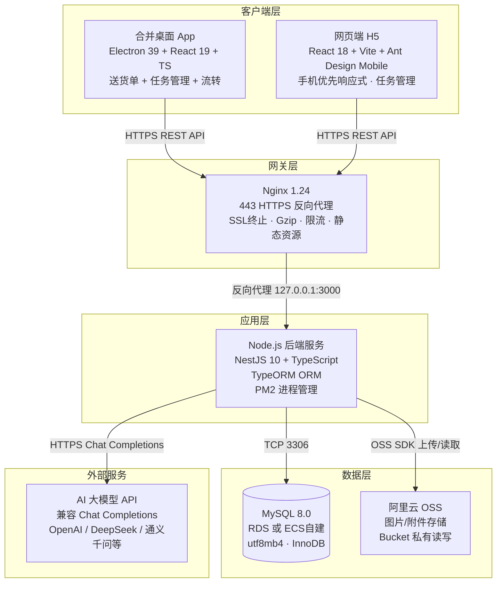

# 系统总体架构与部署文档

文档版本：1.0；基准日期：2026-09-22；适用范围：合并桌面 App + 网页端 H5 + Node.js 云端服务。

配套文档：[云端数据库设计文档](01-云端数据库设计文档.md)。

---

## 1. 项目背景与目标

### 1.1 背景

天美意（tmy）与趣趣特（tri）两家公司目前各使用一套独立的本地桌面工具：

- **送货单 App**（`tmy-tri-delivery-manager` 1.0.20，appId `com.tmytri.delivery-manager`）：Electron 39 + React 19.2 + TypeScript 5.9 + Vite 7.2，使用 Electron 内置 `node:sqlite` 的 `DatabaseSync` 做本地持久化。支持双公司隔离开单、客户/产品/分类/人员基础资料维护、送货汇总、CSV/Excel 导出、针式打印机打印、打印模板自定义编辑、JSON 备份恢复。无账号系统、无云端、单用户本地操作，IPC 桥接 `window.deliveryApi`，返回风格不统一。
- **任务管理 App**（`wechat-order-task-manager` 1.0.0，appId `com.tmy.wechat-order-tasks`，代码在 `app/` 子目录）：Electron 39 + React 18.3 + Ant Design 5.27 + React Router 6 + Zustand 5，使用 `better-sqlite3` 12.4 做本地持久化。支持启动密码（scrypt 哈希）、微信群文本 AI 解析录入、任务分配（部门+执行人）、六种状态流转、图片附件（BLOB 存储 PNG，最多 12 张）、Excel 导出、SQLite 备份恢复。IPC 桥接 `window.api`，统一响应 `Result<T> = { ok, data/error }`。

两套工具数据完全隔离，任务完成后无法自动流转到送货单开单，老板只能在电脑前操作，手机无法及时分配任务。

### 1.2 核心目标

1. **合并为一个桌面 App**：将送货单与任务管理合并为同一个 Electron 应用，统一技术栈、统一账号体系、统一 IPC 桥接风格，共享基础资料（客户、产品、人员、部门、员工、分类）。
2. **任务→送货单流转**：任务管理中状态推进到"待发货/已发货"阶段的任务，可一键流转生成送货单草稿，人工补全产品明细后保存打印。流转生成的送货单通过 `source_task_id` 反向关联任务，可从送货单反查任务；手动新建的送货单不关联任务。
3. **数据上云**：两个 App 的本地 SQLite 数据全部迁移到云端 MySQL 8.0，图片从 BLOB 迁移到阿里云 OSS，实现多端数据共享。
4. **网页端 H5（任务管理）**：老板可在手机浏览器中复制微信群订单信息，通过 AI 解析生成任务草稿，人工校对后分配部门与执行人，实现手机端及时派单。网页端仅包含任务管理功能（AI 录入、任务列表/看板、状态流转、基础资料维护），不包含送货单开单与打印。
5. **HTTPS 安全访问**：使用阿里云 ECS + Nginx 443 端口 SSL 终止，所有 API 请求走 HTTPS，JWT 鉴权。

### 1.3 范围边界

| 端 | 做什么 | 不做什么 |
|---|---|---|
| **合并桌面 App（Electron）** | 送货单全功能（开单/编辑/删除/查询/汇总/打印/Excel导出/模板编辑）、任务管理全功能（AI录入/任务CRUD/状态流转/图片附件/导出/备份）、任务→送货单流转、基础资料统一维护、系统打印（针式打印机） | 不做微信自动监听、不做财务结算/库存扣减、不做收款核销 |
| **网页端 H5（手机优先）** | 登录、AI 订单录入（粘贴群文本→解析→草稿→校对→保存）、任务列表/看板、状态流转、任务详情查看、图片查看（只读）、部门/员工/分类维护、个人密码修改 | 不做送货单开单/打印、不做打印模板编辑、不做 Excel 导出（可后续扩展）、不做系统级打印 |
| **服务器（Node.js + MySQL + OSS）** | RESTful API 服务、JWT 鉴权、多公司数据隔离、AI 解析代理（API Key 服务端管理）、文件上传到 OSS、数据备份、日志记录 | 不做 WebSocket 实时推送（第一期）、不做消息队列、不做微服务拆分 |

---

## 2. 整体架构图



### 2.1 请求流转说明

1. 桌面 App 与网页端均通过 HTTPS（443 端口）访问 Nginx。
2. Nginx 完成 SSL 终止后，将 `/api/*` 请求反向代理到本机 `127.0.0.1:3000` 的 Node.js 服务。
3. Nginx 同时托管网页端 H5 的静态构建产物（`/usr/share/nginx/html/h5/`）。
4. Node.js 服务通过 TypeORM 连接 MySQL 8.0（RDS 内网地址或 ECS 本机 3306）。
5. 图片上传时，Node.js 接收文件后通过阿里云 OSS SDK 上传到 Bucket，返回 OSS URL 存入数据库；读取时返回签名 URL。
6. AI 解析请求由 Node.js 服务端转发到 AI 大模型 API，API Key 仅存在于服务端环境变量，不暴露给客户端。

---

## 3. 技术选型与理由

### 3.1 后端：NestJS（TypeScript）+ TypeORM

| 项目 | 选型 |
|---|---|
| 运行时 | Node.js 20 LTS |
| 框架 | NestJS 10 |
| 语言 | TypeScript 5.x |
| ORM | TypeORM 0.3.x |
| 进程管理 | PM2 5.x |
| API 风格 | RESTful，统一响应 `{ code, message, data }` |

**选型理由：**

- **NestJS** 提供模块化架构（Module/Controller/Service/Guard/Interceptor/Pipe），天然适合多模块业务（认证、任务、送货单、基础资料、AI、文件、导出、系统管理）。依赖注入便于测试和解耦。
- **TypeScript** 与前端（React + TS）共享类型定义，减少前后端类型不一致导致的 bug。
- **TypeORM** 支持 MySQL、迁移（Migration）、事务、Repository 模式，与 NestJS 集成成熟（`@nestjs/typeorm`）。迁移脚本可纳入版本控制，配合 CI/CD 自动执行。
- **PM2** 提供进程守护、集群模式、日志管理、开机自启，适合单 ECS 部署。

### 3.2 数据库：MySQL 8.0

| 项目 | 配置 |
|---|---|
| 版本 | MySQL 8.0.x |
| 字符集 | `utf8mb4` / `utf8mb4_unicode_ci` |
| 引擎 | InnoDB |
| 时区 | `+08:00`（Asia/Shanghai） |
| 连接池 | 最小 5，最大 20 |

**与原 SQLite 的差异处理：**

| 差异点 | SQLite 现状 | MySQL 处理 |
|---|---|---|
| 自增 ID | `INTEGER PRIMARY KEY AUTOINCREMENT` | `BIGINT UNSIGNED AUTO_INCREMENT PRIMARY KEY` |
| 主键类型 | 送货单用 `TEXT` UUID，任务用 `INTEGER` | 统一为 `BIGINT UNSIGNED AUTO_INCREMENT`，迁移时重新生成并维护 ID 映射 |
| 布尔值 | `INTEGER` 0/1 | `TINYINT(1)` 0/1 |
| 时间 | `TEXT` 存储 `YYYY-MM-DD HH:mm:ss`（本地时间） | `DATETIME` 类型，默认 `CURRENT_TIMESTAMP`，统一存北京时间 |
| JSON | `TEXT` 存储 JSON 字符串（送货单 payload） | 送货单明细拆为独立明细表；配置类 JSON 用 `JSON` 类型 |
| BLOB | 任务图片 `BLOB` 存储 PNG | 图片迁移到 OSS，数据库只存 `oss_url` 和 `oss_key` |
| 外键 | 任务 App 开启外键约束，送货单 App 无外键 | 逻辑外键（不强制 `FOREIGN KEY CONSTRAINT`），通过应用层校验保证关联完整性 |
| 分页 | 全量查询前端分页 | 后端 `LIMIT/OFFSET` 分页，默认每页 20 条 |
| 大小写敏感 | SQLite 默认二进制比较 | `utf8mb4_unicode_ci` 不区分大小写，拼音检索在应用层实现 |

### 3.3 文件存储：阿里云 OSS

| 项目 | 配置 |
|---|---|
| 存储类型 | 阿里云对象存储 OSS |
| Bucket 命名 | `tmy-tri-app-images`（全局唯一，需实际申请时确认） |
| 地域 | 与 ECS 同地域（如华东1杭州 `oss-cn-hangzhou`），走内网 endpoint 免流量费 |
| 读写权限 | 私有（private），通过服务端签名 URL 访问 |
| 存储类型 | 标准存储 |
| 目录结构 | `{company_id}/tasks/{year}/{month}/{uuid}.png` |

**图片从 BLOB 迁移到 OSS 的方案：**

1. 迁移脚本读取任务管理 SQLite 中 `task_images` 表的每条记录，取出 `data` BLOB 字段。
2. 生成 UUID 文件名（保留 `.png` 扩展名），按 `{company_id}/tasks/{year}/{month}/` 路径组织。
3. 通过阿里云 OSS SDK（`ali-oss`）调用 `put()` 方法上传 BLOB Buffer，设置 `Content-Type: image/png`。
4. 上传成功后，将返回的 OSS Key 和 URL 写入 MySQL `task_images` 表，同时维护旧 `task_image_id` → 新 `task_image_id` 的映射。
5. 全部上传完成后，对比 SQLite 图片行数与 MySQL 图片行数、OSS 对象数，确保一致。
6. 桌面 App 和网页端新增图片时，前端将图片文件以 `multipart/form-data` 上传到后端 `/api/files/upload`，后端校验格式（PNG/JPG/WebP）、大小（≤10MiB）、像素（≤2400万）后上传 OSS，返回 `{ oss_url, oss_key }`。
7. 读取图片时，后端返回 OSS 签名 URL（有效期 1 小时），前端直接 `` 加载；列表缩略图由 OSS 图片处理参数（`?x-oss-process=image/resize,w_160`）实时生成，不单独存储缩略图。

### 3.4 桌面端：Electron 39 + React 19 + TypeScript + Vite

| 项目 | 配置 |
|---|---|
| Electron | 39.x |
| React | 19.x（任务 App 从 18.3 升级） |
| TypeScript | 5.9.x |
| Vite | 7.2.x |
| UI 组件库 | Ant Design 5.x（桌面端统一使用，送货单 App 原无组件库需引入） |
| 状态管理 | Zustand 5.x |
| 路由 | React Router 6.x（HashRouter，适配 file:// 协议） |
| HTTP 客户端 | Axios（统一拦截器：JWT 注入、401 刷新、错误提示） |
| 打包 | electron-builder 26.x，Windows NSIS x64 + Mac DMG |
| appId | `com.tmytri.manager`（合并后新 appId） |
| package | `tmy-tri-manager` |

**合并后统一技术栈说明：**

- 任务管理 App 原使用 React 18.3 + Ant Design 5.27，升级到 React 19 后需验证 Ant Design 5.x 兼容性（Ant Design 5.27+ 已支持 React 19）。
- 送货单 App 原无 UI 组件库，所有界面手写 React + CSS。合并后引入 Ant Design 5.x，逐步将表单、表格、弹窗、按钮等替换为 Ant Design 组件，但打印模板编辑器（`react-rnd` 拖拽）和打印 DOM 保持独立实现。
- 原送货单 App 的 IPC 桥接 `window.deliveryApi` 返回风格不统一，合并后统一为 `window.api`，所有 IPC 方法返回 `Result<T> = { ok: true, data: T } | { ok: false, error: string }`，与原任务 App 风格一致。
- 原送货单 App 使用 `node:sqlite`，原任务 App 使用 `better-sqlite3`。合并上云后，桌面端不再直接操作本地 SQLite 业务数据，所有业务数据通过 HTTPS API 从云端获取；本地仅用 `IndexedDB` 做只读缓存（见第 9 章）。
- 系统打印能力（针式打印机静默打印）仍由 Electron 主进程的 `webContents.print()` 实现，这是桌面端独有的能力，网页端不具备。

### 3.5 网页端：React 18 + Vite + Ant Design Mobile 5 + React Router + Zustand

| 项目 | 配置 |
|---|---|
| React | 18.x |
| Vite | 5.x |
| UI 组件库 | Ant Design Mobile 5.x（`antd-mobile`） |
| 路由 | React Router 6.x（BrowserRouter） |
| 状态管理 | Zustand 5.x |
| HTTP 客户端 | Axios（拦截器同桌面端） |
| 适配策略 | 手机优先响应式，viewport `width=device-width, initial-scale=1, maximum-scale=1, user-scalable=no` |
| 构建输出 | `dist/` 静态文件，由 Nginx 托管 |
| 部署路径 | `https://域名/h5/` |

**手机优先响应式说明：**

- 设计基准宽度 375px（iPhone SE/标准安卓），使用 `rem` 或 `vw` 适配，最大宽度限制 480px（平板/桌面浏览器访问时居中显示）。
- Ant Design Mobile 提供适配移动端的组件（NavBar、TabBar、Card、List、InputItem、Picker、Modal、Toast、PullToRefresh、InfiniteScroll）。
- 任务列表使用下拉刷新 + 上拉加载更多（InfiniteScroll），不使用桌面端的分页表格。
- 看板视图在手机端改为可横向滚动的六列状态卡片，或切换为 Tab 切换单状态列表。
- AI 录入页面提供大文本输入框（支持粘贴），解析后草稿以卡片列表展示，逐条校对保存。
- 图片查看使用全屏 Lightbox，支持左右滑动切换、双指缩放。
- 网页端不调用任何 Electron IPC，所有功能通过 HTTPS API 完成。

### 3.6 鉴权：JWT（Access Token + Refresh Token）

| 项目 | 配置 |
|---|---|
| 认证方式 | JWT（JSON Web Token） |
| Access Token | 有效期 2 小时，载荷 `{ sub: user_id, company_id, role, username }` |
| Refresh Token | 有效期 30 天，存数据库 `refresh_tokens` 表（token_hash + expires_at + revoked_at） |
| 算法 | HS256，密钥从环境变量 `JWT_SECRET` 读取（≥32 字节随机字符串） |
| 传输 | Access Token 通过 HTTP Header `Authorization: Bearer <token>` 传输；Refresh Token 通过 `POST /api/auth/refresh` 的 body 传输 |
| 存储（桌面端） | Access Token 存内存（Zustand store），Refresh Token 存 Electron `safeStorage` 加密后的本地文件 |
| 存储（网页端） | Access Token 存内存（Zustand store），Refresh Token 存 `HttpOnly + Secure + SameSite=Strict` 的 Cookie |
| HTTPS only | 所有 Token 仅通过 HTTPS 传输，Nginx 强制 80→443 跳转 |
| 登出 | 后端将 Refresh Token 标记为 `revoked_at`，前端清除内存 Token |

**刷新流程：**

1. 前端请求返回 401 时，Axios 拦截器自动调用 `POST /api/auth/refresh` 携带 Refresh Token。
2. 后端校验 Refresh Token 的 hash、有效期、是否已撤销，有效则签发新的 Access Token（可选同时轮换 Refresh Token）。
3. 前端用新 Access Token 重放原请求；若 Refresh Token 也失效，跳转登录页。
4. 并发请求 401 时，使用 Promise 队列确保只刷新一次。

---

## 4. 模块划分

后端采用 NestJS 模块化架构，共 8 个业务模块：

### 4.1 认证模块（AuthModule）

- **职责**：用户注册（仅管理员）、登录、登出、Token 刷新、密码修改、登录限流。
- **Controller**：`AuthController`，路由前缀 `/api/auth`。
- **Service**：`AuthService`，密码使用 `bcrypt`（cost factor 12）哈希，登录连续 5 次失败后冷却 30 秒（内存计数）。
- **Guard**：`JwtAuthGuard`（全局守卫，校验 Access Token）、`RolesGuard`（角色权限校验）。
- **接口**：`POST /login`、`POST /logout`、`POST /refresh`、`POST /change-password`、`GET /me`。

### 4.2 任务管理模块（TaskModule）

- **职责**：任务 CRUD、批量创建、状态流转（状态机校验）、任务筛选/分页、任务图片管理、任务导出 Excel、月份归属计算。
- **Controller**：`TaskController`（`/api/tasks`）、`TaskImageController`（`/api/tasks/:id/images`）。
- **Service**：`TaskService`（业务校验：部门-员工归属、状态机流转、月份筛选口径）、`TaskImageService`（图片上传 OSS、删除）。
- **状态机**：`todo → doing → waiting_ship → shipped → delivered`，任意非取消状态可 `→ canceled`，取消后不可重开；创建时可接受任意合法状态。
- **月份归属**：优先 `expected_delivery_at` 所在月，为空取 `created_at` 所在月，SQL 表达式 `DATE_FORMAT(IFNULL(NULLIF(expected_delivery_at,''), created_at), '%Y-%m')`。
- **接口**：`GET /tasks`（分页筛选）、`GET /tasks/:id`、`POST /tasks`、`POST /tasks/batch`、`PUT /tasks/:id`、`DELETE /tasks/:id`、`PATCH /tasks/:id/status`、`GET /tasks/export`、`POST /tasks/:id/images`、`DELETE /tasks/images/:imageId`。

### 4.3 送货单模块（DeliveryNoteModule）

- **职责**：送货单 CRUD、单号生成、明细管理、送货汇总、打印状态更新、Excel 导出、任务→送货单流转。
- **Controller**：`DeliveryNoteController`（`/api/delivery-notes`）、`DeliverySummaryController`（`/api/delivery-summary`）。
- **Service**：`DeliveryNoteService`（单号生成规则、明细校验最多 5 行、客户/产品快照保存）、`DeliverySummaryService`（按客户/分类/产品/单据维度汇总）、`DeliveryExportService`（Excel 导出，复用原 OpenXML 修改逻辑）。
- **单号规则**：公司大写前缀 + 送货日期 `YYMMDD` + 当前 `HHmmss` + 当日同公司序号（3 位补零），如 `TRI260922143052001`。通过 `app_meta` 表维护当日序号，数据库 `UNIQUE(company_id, note_number)` 做最终冲突保护。
- **流转接口**：`POST /api/delivery-notes/from-task/:taskId`，根据任务信息（标题、详情、客户名推断、预计交付时间）生成送货单草稿（`is_draft=1`），填充 `source_task_id`，返回草稿供前端补全产品明细后保存。
- **接口**：`GET /delivery-notes`、`GET /delivery-notes/:id`、`POST /delivery-notes`、`PUT /delivery-notes/:id`、`DELETE /delivery-notes/:id`、`PATCH /delivery-notes/:id/printed`、`POST /delivery-notes/from-task/:taskId`、`GET /delivery-summary`、`GET /delivery-notes/export`、`POST /delivery-notes/export-batch`。

### 4.4 基础资料模块（CatalogModule）

- **职责**：客户、客户分类、产品、部门、员工、业务分类、人员（署名池）的统一维护。
- **Controller**：`CustomerController`、`CustomerCategoryController`、`ProductController`、`DepartmentController`、`EmployeeController`、`CategoryController`、`PersonnelController`。
- **Service**：各资源独立 Service，统一处理软删除（`deleted_at`）、删除保护（有关联非取消任务的部门/员工不可删除）、排序（`sort` 字段）。
- **删除保护规则**：
  - 部门：存在任意非取消状态任务关联时不可删除；删除部门同步逻辑删除其下员工。
  - 员工：存在任意非取消状态任务关联时不可删除；有非取消任务时不可调往其他部门。
  - 客户分类：有有效客户使用时不可删除；"未分类"为保留分类不可删除/重命名。
  - 业务分类：删除为停用式，历史任务保留关联，新任务不可选。
- **接口**：各资源标准 RESTful 接口（`GET /api/customers`、`POST /api/customers` 等）。

### 4.5 AI 解析模块（AiModule）

- **职责**：接收用户粘贴的微信群文本，调用兼容 Chat Completions 的 AI 大模型 API 解析为任务草稿，返回前端校对。
- **Controller**：`AiController`，路由 `/api/ai`。
- **Service**：`AiService`，从环境变量读取 `AI_API_BASE_URL`、`AI_API_KEY`、`AI_MODEL_NAME`（或从 `ai_configs` 表读取公司级模型偏好），构造 system message（含今天日期、字段 schema、当前有效分类/部门名称），调用 `/chat/completions`，解析返回 JSON，校验字段合法性后返回草稿列表。
- **安全**：API Key 仅存在服务端，不返回给前端；请求超时 60 秒；401/403/429/超时分别处理；不自动重试。
- **接口**：`POST /api/ai/parse`（入参 `{ text: string }`，出参 `{ items: AiDraft[] }`）、`POST /api/ai/test`（连接测试）。

### 4.6 文件/图片模块（FileModule）

- **职责**：通用文件上传到 OSS、图片校验、签名 URL 生成。
- **Controller**：`FileController`，路由 `/api/files`。
- **Service**：`FileService`，封装阿里云 OSS SDK（`ali-oss`），提供 `upload(buffer, options)`、`getSignedUrl(ossKey, expiresIn)`、`delete(ossKey)` 方法。
- **上传校验**：文件类型（PNG/JPG/JPEG/WebP）、大小（≤10MiB）、像素（≤2400万，使用 `sharp` 库读取元数据）。
- **接口**：`POST /api/files/upload`（multipart/form-data，字段名 `file`，返回 `{ oss_url, oss_key, size, mime_type }`）、`GET /api/files/signed-url?key=xxx`（返回签名 URL）。

### 4.7 导出备份模块（ExportModule）

- **职责**：任务 Excel 导出、送货单 Excel 导出（单张/批量合并）、送货汇总 CSV 导出、全量数据 JSON 备份、备份恢复。
- **Controller**：`ExportController`、`BackupController`。
- **Service**：`TaskExportService`（ExcelJS 生成任务清单）、`DeliveryExportService`（adm-zip + xmldom 修改 OpenXML 模板）、`BackupService`（全量数据导出 JSON / 从 JSON 恢复，恢复前自动备份当前数据库）。
- **接口**：`GET /api/export/tasks`、`GET /api/export/delivery-notes/:id`、`POST /api/export/delivery-notes/batch`、`GET /api/export/delivery-summary.csv`、`GET /api/backup/export`、`POST /api/backup/restore`。

### 4.8 系统管理模块（SystemModule）

- **职责**：公司管理、用户管理、打印模板管理、系统设置、AI 配置、应用元数据、操作日志。
- **Controller**：`CompanyController`、`UserController`、`PrintTemplateController`、`SettingController`、`AiConfigController`、`AppMetaController`。
- **Service**：各资源独立 Service。
- **打印模板**：`config_json` 字段存储模板配置（纸张、页边距、19 个固定元素位置、表格配置），公司级默认模板通过 `is_default` 标记，同公司仅一个默认。
- **接口**：各资源标准 RESTful 接口。

---

## 5. 阿里云部署方案

### 5.1 ECS 配置建议

| 项目 | 推荐配置 | 说明 |
|---|---|---|
| 实例规格 | ecs.c7.large（2 核 4G）起步 | 业务量小，2 核 4G 足够；后续可升级到 ecs.c7.xlarge（4 核 8G） |
| 操作系统 | Alibaba Cloud Linux 3.2104 LTS 64位 | 兼容 CentOS 生态，阿里云官方维护，安全更新及时 |
| 系统盘 | ESSD 云盘 40GiB，PL0 性能 | 系统 + 应用 + 日志，40G 足够；MySQL 自建时建议升级到 100GiB |
| 带宽 | 按使用流量，峰值 5Mbps | 日常 API 请求流量小，图片走 OSS 不占 ECS 带宽；5Mbps 峰值足够 |
| 安全组 | 入方向开放 443（HTTPS）、22（SSH，建议限制源 IP） | 80 端口开放用于自动跳转 443；3306 不对外开放 |
| 实例数量 | 1 台 | 单实例部署 Nginx + Node.js + （可选 MySQL） |

**ECS 初始化命令：**

```bash
# 系统更新
sudo dnf update -y

# 安装基础工具
sudo dnf install -y git curl wget vim unzip tar gcc-c++ make

# 安装 Node.js 20 LTS（使用 NodeSource 源）
curl -fsSL https://rpm.nodesource.com/setup_20.x | sudo bash -
sudo dnf install -y nodejs
node -v  # 验证 v20.x

# 安装 PM2
sudo npm install -g pm2
pm2 startup  # 配置开机自启，按提示执行输出的命令

# 安装 Nginx 1.24
sudo dnf install -y nginx
sudo systemctl enable nginx
sudo systemctl start nginx

# 安装 MySQL 8.0 客户端
sudo dnf install -y mysql
```

### 5.2 Nginx 配置

Nginx 负责：443 端口 SSL 终止、反向代理到 Node.js（3000 端口）、托管网页端 H5 静态资源、Gzip 压缩、请求限流、超时配置。

**主配置文件 `/etc/nginx/nginx.conf`：**

```nginx
user nginx;
worker_processes auto;
error_log /var/log/nginx/error.log warn;
pid /run/nginx.pid;

events {
    worker_connections 2048;
    use epoll;
    multi_accept on;
}

http {
    include /etc/nginx/mime.types;
    default_type application/octet-stream;

    log_format main '$remote_addr - $remote_user [$time_local] "$request" '
                    '$status $body_bytes_sent "$http_referer" '
                    '"$http_user_agent" "$http_x_forwarded_for" '
                    'rt=$request_time uct=$upstream_connect_time '
                    'uht=$upstream_header_time urt=$upstream_response_time';

    access_log /var/log/nginx/access.log main;

    sendfile on;
    tcp_nopush on;
    tcp_nodelay on;
    keepalive_timeout 65;
    keepalive_requests 1000;
    types_hash_max_size 2048;
    server_tokens off;

    gzip on;
    gzip_vary on;
    gzip_proxied any;
    gzip_comp_level 6;
    gzip_min_length 1024;
    gzip_types
        text/plain text/css text/xml text/javascript
        application/javascript application/x-javascript application/json
        application/xml application/xml+rss application/vnd.ms-fontobject
        application/x-font-ttf font/opentype image/svg+xml image/x-icon;

    limit_req_zone $binary_remote_addr zone=api_limit:10m rate=10r/s;
    client_max_body_size 20m;
    client_body_buffer_size 2m;

    include /etc/nginx/conf.d/*.conf;
}
```

**站点配置 `/etc/nginx/conf.d/app.conf`：**

```nginx
# HTTP 80 端口：强制跳转 HTTPS
server {
    listen 80;
    server_name your-domain.com www.your-domain.com;
    return 301 https://$host$request_uri;
}

# HTTPS 443 端口
server {
    listen 443 ssl http2;
    server_name your-domain.com www.your-domain.com;

    ssl_certificate /etc/nginx/ssl/your-domain.com.pem;
    ssl_certificate_key /etc/nginx/ssl/your-domain.com.key;

    ssl_protocols TLSv1.2 TLSv1.3;
    ssl_ciphers ECDHE-ECDSA-AES128-GCM-SHA256:ECDHE-RSA-AES128-GCM-SHA256:ECDHE-ECDSA-AES256-GCM-SHA384:ECDHE-RSA-AES256-GCM-SHA384:ECDHE-ECDSA-CHACHA20-POLY1305:ECDHE-RSA-CHACHA20-POLY1305:DHE-RSA-AES128-GCM-SHA256:DHE-RSA-AES256-GCM-SHA384;
    ssl_prefer_server_ciphers off;
    ssl_session_cache shared:SSL:10m;
    ssl_session_timeout 1d;
    ssl_session_tickets off;

    add_header Strict-Transport-Security "max-age=63072000; includeSubDomains" always;
    add_header X-Content-Type-Options nosniff always;
    add_header X-Frame-Options SAMEORIGIN always;
    add_header X-XSS-Protection "1; mode=block" always;
    add_header Referrer-Policy "strict-origin-when-cross-origin" always;

    # 网页端 H5 静态资源
    location /h5/ {
        alias /usr/share/nginx/html/h5/;
        index index.html;
        try_files $uri $uri/ /h5/index.html;

        location ~* \.(js|css|png|jpg|jpeg|gif|ico|svg|woff|woff2|ttf|eot)$ {
            expires 30d;
            add_header Cache-Control "public, immutable";
        }
        location ~* \.html$ {
            add_header Cache-Control "no-cache, no-store, must-revalidate";
        }
    }

    # API 反向代理到 Node.js
    location /api/ {
        limit_req zone=api_limit burst=20 nodelay;
        proxy_pass http://127.0.0.1:3000;
        proxy_http_version 1.1;
        proxy_set_header Host $host;
        proxy_set_header X-Real-IP $remote_addr;
        proxy_set_header X-Forwarded-For $proxy_add_x_forwarded_for;
        proxy_set_header X-Forwarded-Proto $scheme;
        proxy_set_header X-Forwarded-Host $host;
        proxy_set_header X-Forwarded-Port $server_port;
        proxy_set_header Upgrade $http_upgrade;
        proxy_set_header Connection "upgrade";
        proxy_connect_timeout 10s;
        proxy_send_timeout 60s;
        proxy_read_timeout 60s;
        proxy_buffering on;
        proxy_buffer_size 8k;
        proxy_buffers 8 8k;
        proxy_busy_buffers_size 16k;
    }

    location = / {
        return 301 /h5/;
    }

    location = /health {
        access_log off;
        return 200 "ok\n";
        add_header Content-Type text/plain;
    }
}
```

**配置验证与重载：**

```bash
sudo nginx -t
sudo systemctl reload nginx
```

### 5.3 SSL 证书

**阿里云免费证书申请与部署步骤：**

1. 登录阿里云控制台 → 数字证书管理服务 → 免费证书 → 立即购买（0 元，单次有效期 1 年）。
2. 证书申请：填写域名（如 `your-domain.com`，可同时申请 `www.your-domain.com`），选择 DNS 验证方式。
3. DNS 验证：按提示在域名解析中添加一条 TXT 记录，等待验证通过（通常几分钟）。
4. 证书签发后，下载 Nginx 版本证书，得到 `.pem`（证书链）和 `.key`（私钥）两个文件。
5. 上传到 ECS：

```bash
sudo mkdir -p /etc/nginx/ssl
sudo chmod 700 /etc/nginx/ssl
# 从本地上传（替换为实际路径和 ECS 公网 IP）
scp your-domain.com.pem root@<ECS公网IP>:/etc/nginx/ssl/
scp your-domain.com.key root@<ECS公网IP>:/etc/nginx/ssl/
sudo chmod 600 /etc/nginx/ssl/your-domain.com.pem
sudo chmod 600 /etc/nginx/ssl/your-domain.com.key
```

6. 确认 Nginx 配置中 `ssl_certificate` 和 `ssl_certificate_key` 路径正确，执行 `sudo nginx -t && sudo systemctl reload nginx`。
7. 验证：浏览器访问 `https://your-domain.com`，地址栏显示锁标志；或使用 `curl -vI https://your-domain.com` 查看证书信息。

**证书续期**：免费证书到期前 30 天，阿里云会发送提醒，需重新申请并替换证书文件后 reload Nginx。

### 5.4 Node.js 部署

**项目目录结构：**

```text
/opt/tmy-tri-manager/
├── server/                 # 后端 NestJS 项目
│   ├── dist/
│   ├── src/
│   ├── package.json
│   ├── tsconfig.json
│   ├── nest-cli.json
│   ├── .env
│   ├── .env.example
│   └── ecosystem.config.js
├── h5/                     # 网页端构建产物
└── shared/                 # 前后端共享类型定义
```

**环境变量 `/opt/tmy-tri-manager/server/.env`：**

```bash
NODE_ENV=production
PORT=3000

DB_HOST=rm-xxxxxxx.mysql.rds.aliyuncs.com
DB_PORT=3306
DB_USERNAME=app_user
DB_PASSWORD=YourStrongPassword123!
DB_DATABASE=tmy_tri_manager
DB_CHARSET=utf8mb4

JWT_SECRET=replace-with-64-byte-random-hex-string
JWT_ACCESS_EXPIRES_IN=2h
JWT_REFRESH_EXPIRES_IN=30d

OSS_REGION=oss-cn-hangzhou
OSS_BUCKET=tmy-tri-app-images
OSS_ACCESS_KEY_ID=LTAIxxxxxxxxxxxxxx
OSS_ACCESS_KEY_SECRET=xxxxxxxxxxxxxxxxxxxxxxxxxxxx
OSS_ENDPOINT=https://oss-cn-hangzhou-internal.aliyuncs.com
OSS_PUBLIC_ENDPOINT=https://tmy-tri-app-images.oss-cn-hangzhou.aliyuncs.com

AI_API_BASE_URL=https://api.deepseek.com
AI_API_KEY=YOUR_API_KEY
AI_MODEL_NAME=deepseek-chat

CORS_ORIGINS=https://your-domain.com,https://www.your-domain.com
LOG_LEVEL=info
LOG_DIR=/var/log/tmy-tri-manager
```

**生成 JWT 密钥：** `openssl rand -hex 32`

**PM2 配置 `/opt/tmy-tri-manager/server/ecosystem.config.js`：**

```javascript
module.exports = {
  apps: [{
    name: 'tmy-tri-server',
    script: './dist/main.js',
    cwd: '/opt/tmy-tri-manager/server',
    instances: 1,
    exec_mode: 'fork',
    autorestart: true,
    watch: false,
    max_memory_restart: '512M',
    env: { NODE_ENV: 'production', PORT: 3000 },
    env_file: '/opt/tmy-tri-manager/server/.env',
    error_file: '/var/log/tmy-tri-manager/error.log',
    out_file: '/var/log/tmy-tri-manager/out.log',
    log_date_format: 'YYYY-MM-DD HH:mm:ss',
    merge_logs: true,
    time: true,
  }],
};
```

**部署命令：**

```bash
sudo mkdir -p /var/log/tmy-tri-manager
sudo chown -R $USER:$USER /var/log/tmy-tri-manager
cd /opt/tmy-tri-manager/server
npm ci --omit=dev
npm run build
pm2 start ecosystem.config.js
pm2 save
pm2 status
pm2 logs tmy-tri-server --lines 50
```

**更新部署：**

```bash
cd /opt/tmy-tri-manager/server
git pull origin main
npm ci --omit=dev
npm run build
pm2 reload tmy-tri-server
```

### 5.5 MySQL 部署

#### 方案 A：阿里云 RDS（推荐）

| 项目 | 配置 |
|---|---|
| 系列 | RDS MySQL 基础版（预算允许推荐高可用版） |
| 版本 | MySQL 8.0 |
| 规格 | 1 核 2G 起步，后续可升级 |
| 存储 | ESSD 云盘 20G 起步，可自动扩容 |
| 地域 | 与 ECS 同地域同可用区 |
| 网络 | 专有网络 VPC，与 ECS 在同一 VPC |
| 白名单 | 添加 ECS 内网 IP，不开放公网访问 |
| 字符集 | `utf8mb4`，排序规则 `utf8mb4_unicode_ci` |
| 时区 | `+08:00` |

**RDS 创建后配置：**

```bash
mysql -h rm-xxxxxxx.mysql.rds.aliyuncs.com -P 3306 -u root -p

CREATE DATABASE tmy_tri_manager
  DEFAULT CHARACTER SET utf8mb4
  DEFAULT COLLATE utf8mb4_unicode_ci;

CREATE USER 'app_user'@'%' IDENTIFIED BY 'YourStrongPassword123!';
GRANT SELECT, INSERT, UPDATE, DELETE, CREATE, ALTER, INDEX, DROP, REFERENCES
  ON tmy_tri_manager.* TO 'app_user'@'%';
FLUSH PRIVILEGES;
```

**RDS 备份策略**：每日凌晨 2:00 全量备份，保留 7 天；Binlog 实时备份，支持按时间点恢复（PITR）。

#### 方案 B：ECS 自建 MySQL

```bash
sudo dnf install -y @mysql:8.0
sudo systemctl enable --now mysqld
sudo grep 'temporary password' /var/log/mysqld.log
sudo mysql_secure_installation

sudo tee /etc/my.cnf.d/charset.cnf <<'EOF'
[mysqld]
character-set-server=utf8mb4
collation-server=utf8mb4_unicode_ci
default-time-zone='+08:00'
max_connections=200
innodb_buffer_pool_size=1G
slow_query_log=1
slow_query_log_file=/var/log/mysql-slow.log
long_query_time=2
EOF
sudo systemctl restart mysqld
```

**自建 MySQL 备份脚本 `/opt/backup/mysql-backup.sh`：**

```bash
#!/bin/bash
BACKUP_DIR=/opt/backup/mysql
DATE=$(date +%Y%m%d_%H%M%S)
mkdir -p $BACKUP_DIR
mysqldump -u app_user -p'YourStrongPassword123!' \
  --single-transaction --routines --triggers \
  tmy_tri_manager | gzip > $BACKUP_DIR/tmy_tri_manager_$DATE.sql.gz
find $BACKUP_DIR -name "*.sql.gz" -mtime +7 -delete
```

```bash
chmod +x /opt/backup/mysql-backup.sh
(crontab -l 2>/dev/null; echo "30 2 * * * /opt/backup/mysql-backup.sh") | crontab -
```

#### 两种方案对比

| 维度 | 阿里云 RDS | ECS 自建 |
|---|---|---|
| 成本 | 约 60-150 元/月 | 0 元（复用 ECS 资源），但占用 ECS CPU/内存/磁盘 |
| 高可用 | 高可用版支持主备自动切换 | 需自行配置主从，单点故障风险 |
| 备份恢复 | 自动备份 + PITR，控制台一键恢复 | 需自行写脚本，手动恢复 |
| 维护成本 | 低 | 高 |
| 推荐度 | **推荐** | 仅预算极有限时使用 |

### 5.6 OSS 配置

**Bucket 创建步骤：**

1. 阿里云控制台 → 对象存储 OSS → Bucket 列表 → 创建 Bucket。
2. Bucket 名称：`tmy-tri-app-images`（全局唯一，如已被占用则加后缀）。
3. 地域：与 ECS 相同地域（如华东1杭州）。
4. 存储类型：标准存储。
5. 读写权限：私有（private）。
6. 版本控制：关闭。
7. 服务端加密：关闭（或启用 SSE-OSS）。

**AccessKey 配置：**

1. 访问控制 RAM → 用户 → 创建用户，勾选"OpenAPI 调用访问"。
2. 记录 AccessKey ID 和 Secret（仅显示一次）。
3. 为该用户添加权限：`AliyunOSSFullAccess`（或自定义策略仅允许指定 Bucket）。
4. 填入后端 `.env` 的 `OSS_ACCESS_KEY_ID` 和 `OSS_ACCESS_KEY_SECRET`。

**跨域 CORS 配置（Bucket → 数据安全 → 跨域设置）：**

| 配置项 | 值 |
|---|---|
| 来源 | `https://your-domain.com` |
| 允许 Methods | `GET, POST, PUT, DELETE, HEAD` |
| 允许 Headers | `*` |
| 暴露 Headers | `ETag, x-oss-request-id` |
| 缓存时间 | 3600 秒 |

**生命周期规则**：第一期删除图片时直接物理删除，不配置生命周期。后续如需回收站，再配置 `deleted/` 前缀 365 天后自动删除。

### 5.7 域名配置

1. 阿里云域名控制台（或其他注册商）找到域名 `your-domain.com`。
2. 添加 DNS 解析记录：

| 记录类型 | 主机记录 | 记录值 | TTL |
|---|---|---|---|
| A | @ | ECS 公网 IP | 600 |
| A | www | ECS 公网 IP | 600 |

3. 等待 DNS 生效（`dig your-domain.com` 验证）。
4. 确认 Nginx `server_name` 正确，SSL 证书已部署。
5. 浏览器访问 `https://your-domain.com/h5/` 验证网页端，`https://your-domain.com/api/health` 验证 API。

---

## 6. HTTPS 安全配置

### 6.1 强制 HTTPS

Nginx 配置中已包含 80 端口 301 跳转 443（见 5.2 节）。同时在 Node.js 后端通过 `@nestjs/helmet` 中间件设置安全头，确保浏览器自动将 HTTP 请求升级为 HTTPS。

### 6.2 HSTS 头

Nginx 配置中已添加：

```nginx
add_header Strict-Transport-Security "max-age=63072000; includeSubDomains" always;
```

- `max-age=63072000`：2 年，浏览器在此期间内始终使用 HTTPS 访问该域名。
- `includeSubDomains`：所有子域名也适用 HSTS。
- **注意**：启用 HSTS 前务必确保 HTTPS 稳定运行至少 1-2 周，且所有子域名都支持 HTTPS。首次部署可先设置 `max-age=300`（5 分钟）测试，稳定后逐步增大。

### 6.3 TLS 配置

Nginx 配置中已设置：

```nginx
ssl_protocols TLSv1.2 TLSv1.3;
ssl_ciphers ECDHE-ECDSA-AES128-GCM-SHA256:ECDHE-RSA-AES128-GCM-SHA256:ECDHE-ECDSA-AES256-GCM-SHA384:ECDHE-RSA-AES256-GCM-SHA384:ECDHE-ECDSA-CHACHA20-POLY1305:ECDHE-RSA-CHACHA20-POLY1305:DHE-RSA-AES128-GCM-SHA256:DHE-RSA-AES256-GCM-SHA384;
ssl_prefer_server_ciphers off;
ssl_session_cache shared:SSL:10m;
ssl_session_timeout 1d;
ssl_session_tickets off;
```

- 仅启用 TLS 1.2 和 TLS 1.3，禁用 SSLv3/TLS 1.0/TLS 1.1（存在已知漏洞）。
- 加密套件仅使用 ECDHE/DHE 前向保密 + AES-GCM/CHACHA20-POLY1305 认证加密，禁用 RC4、3DES、CBC 模式等弱套件。
- `ssl_session_tickets off`：禁用会话票据（存在前向保密风险），使用服务端会话缓存。

**验证 TLS 配置**：使用 [SSL Labs Server Test](https://www.ssllabs.com/ssltest/) 扫描，目标评级 A 以上。

### 6.4 JWT 密钥管理

- JWT 签名密钥（`JWT_SECRET`）存储在服务器环境变量 `.env` 文件中，**不存入数据库、不写入代码仓库、不记录日志**。
- `.env` 文件权限设置为 `chmod 600`，仅应用进程用户可读。
- 密钥使用 `openssl rand -hex 32` 生成 64 字符十六进制随机字符串（256 位熵）。
- 密钥轮换：如怀疑密钥泄露，立即更换 `JWT_SECRET` 并重启服务，所有已签发的 Access Token 将失效，用户需重新登录。Refresh Token 不受 JWT_SECRET 影响（存数据库），但建议同时清理 `refresh_tokens` 表。
- 数据库中 `refresh_tokens` 表存储的是 token 的 SHA-256 哈希（`token_hash`），不存明文 Refresh Token。

### 6.5 API 限流

**Nginx 层限流**（已在 5.2 节配置）：

```nginx
limit_req_zone $binary_remote_addr zone=api_limit:10m rate=10r/s;
# 在 /api/ location 中：
limit_req zone=api_limit burst=20 nodelay;
```

- 按客户端 IP 限流，每秒 10 个请求，突发 20 个（`nodelay` 表示突发请求不排队，直接处理，超过则返回 503）。

**后端层限流**（使用 `@nestjs/throttler`）：

```typescript
// app.module.ts
import { ThrottlerModule, ThrottlerGuard } from '@nestjs/throttler';

@Module({
  imports: [
    ThrottlerModule.forRoot([{
      ttl: 60,
      limit: 300,
    }]),
  ],
  providers: [
    { provide: APP_GUARD, useClass: ThrottlerGuard },
  ],
})
export class AppModule {}
```

- 登录接口单独设置更严格的限流：`@Throttle({ default: { ttl: 60, limit: 10 } })`（每分钟最多 10 次登录尝试）。

### 6.6 CORS 策略

后端使用 `@nestjs/platform-express` 的 CORS 中间件，仅允许白名单域名：

```typescript
// main.ts
const corsOrigins = process.env.CORS_ORIGINS
  ? process.env.CORS_ORIGINS.split(',')
  : ['https://your-domain.com'];

app.enableCors({
  origin: (origin, callback) => {
    if (!origin || corsOrigins.includes(origin)) {
      callback(null, true);
    } else {
      callback(new Error('Not allowed by CORS'));
    }
  },
  methods: ['GET', 'POST', 'PUT', 'PATCH', 'DELETE', 'OPTIONS'],
  allowedHeaders: ['Content-Type', 'Authorization', 'X-Requested-With'],
  exposedHeaders: ['Content-Disposition'],
  credentials: true,
  maxAge: 86400,
});
```

- 白名单域名从环境变量 `CORS_ORIGINS` 读取，多个域名用逗号分隔。
- 桌面 Electron 渲染进程的请求可能不带 `Origin` 头（file:// 协议），因此 `!origin` 时放行。
- 网页端 H5 与 API 同域名，实际不会触发 CORS 预检，但配置好以防后续部署到不同子域名。

---

## 7. CI/CD 与发布流程

### 7.1 Git 仓库结构

使用 Monorepo 结构，一个 Git 仓库包含后端、桌面端、网页端：

```text
tmy-tri-manager/
├── .github/
│   └── workflows/
│       ├── ci.yml
│       └── deploy.yml
├── server/                         # 后端 NestJS
│   ├── src/
│   ├── test/
│   ├── package.json
│   ├── tsconfig.json
│   ├── nest-cli.json
│   ├── .env.example
│   └── ecosystem.config.js
├── desktop/                        # 桌面端 Electron
│   ├── src/
│   ├── electron/
│   ├── package.json
│   ├── tsconfig.json
│   ├── vite.config.ts
│   └── electron-builder.yml
├── h5/                             # 网页端 H5
│   ├── src/
│   ├── package.json
│   ├── tsconfig.json
│   └── vite.config.ts
├── shared/                         # 前后端共享类型定义
│   ├── types/
│   └── package.json
├── docs/
├── scripts/
│   └── migrate-sqlite-to-mysql.ts
├── .gitignore
├── README.md
└── package.json                    # 根 package.json，workspaces 管理
```

**根 `package.json`（npm workspaces）：**

```json
{
  "name": "tmy-tri-manager",
  "version": "1.0.0",
  "private": true,
  "workspaces": ["server", "desktop", "h5", "shared"],
  "scripts": {
    "dev:server": "npm --workspace server run start:dev",
    "dev:desktop": "npm --workspace desktop run dev",
    "dev:h5": "npm --workspace h5 run dev",
    "build:server": "npm --workspace server run build",
    "build:h5": "npm --workspace h5 run build",
    "typecheck": "npm --workspaces run typecheck",
    "test": "npm --workspaces run test"
  }
}
```

### 7.2 GitHub Actions 工作流

**CI 工作流 `.github/workflows/ci.yml`：**

```yaml
name: CI
on:
  push:
    branches: [main, develop]
  pull_request:
    branches: [main, develop]
jobs:
  test:
    runs-on: ubuntu-latest
    strategy:
      matrix:
        workspace: [server, h5]
    steps:
      - uses: actions/checkout@v4
      - uses: actions/setup-node@v4
        with:
          node-version: '20'
          cache: 'npm'
      - run: npm ci
      - run: npm --workspace ${{ matrix.workspace }} run typecheck
      - run: npm --workspace ${{ matrix.workspace }} run test --if-present
```

**部署工作流 `.github/workflows/deploy.yml`：**

```yaml
name: Deploy
on:
  push:
    branches: [main]
jobs:
  deploy:
    runs-on: ubuntu-latest
    environment: production
    steps:
      - uses: actions/checkout@v4
      - uses: actions/setup-node@v4
        with:
          node-version: '20'
          cache: 'npm'
      - run: npm ci
      - run: npm --workspace server run build
      - run: npm --workspace h5 run build
      - name: Deploy via SSH
        uses: appleboy/ssh-action@v1.0.3
        with:
          host: ${{ secrets.ECS_HOST }}
          username: ${{ secrets.ECS_USER }}
          key: ${{ secrets.ECS_SSH_KEY }}
          script: |
            cd /opt/tmy-tri-manager/server
            git pull origin main
            npm ci --omit=dev
            npm run build
            npx typeorm migration:run -d dist/data-source.js
            pm2 reload tmy-tri-server
            cp -r /opt/tmy-tri-manager/h5/dist/* /usr/share/nginx/html/h5/
            sudo systemctl reload nginx
```

**GitHub Secrets**：`ECS_HOST`（ECS 公网 IP）、`ECS_USER`（SSH 用户名）、`ECS_SSH_KEY`（SSH 私钥）。

### 7.3 环境区分

| 环境 | 用途 | 分支 | 域名 | 数据库 |
|---|---|---|---|---|
| dev | 本地开发 | feature/* | localhost:3000 / 5173 | 本地 Docker MySQL |
| staging | 测试验证 | develop | staging.your-domain.com | RDS 测试实例 |
| prod | 生产 | main | your-domain.com | RDS 生产实例 |

- 每个环境使用独立的 `.env` 文件，通过 `NODE_ENV` 区分。
- 数据库迁移脚本在各环境独立执行，staging 验证通过后才在 prod 执行。
- 桌面端通过构建时环境变量（`VITE_API_BASE_URL`）区分 API 地址。

### 7.4 数据库迁移脚本管理

使用 TypeORM Migration：

```typescript
// server/src/migrations/1695000000001-InitialSchema.ts
import { MigrationInterface, QueryRunner } from 'typeorm';

export class InitialSchema1695000000001 implements MigrationInterface {
  name = 'InitialSchema1695000000001';
  public async up(queryRunner: QueryRunner): Promise<void> {
    await queryRunner.query(`CREATE TABLE companies (...)`);
    await queryRunner.query(`CREATE TABLE users (...)`);
    // ... 其余表（详见 01-云端数据库设计文档.md）
  }
  public async down(queryRunner: QueryRunner): Promise<void> {
    await queryRunner.query(`DROP TABLE IF EXISTS users`);
    await queryRunner.query(`DROP TABLE IF EXISTS companies`);
  }
}
```

**迁移命令：**

```bash
npm run typeorm -- migration:generate src/migrations/AddDeliveryNoteSourceTaskId -d src/data-source.ts
npm run typeorm -- migration:run -d dist/data-source.js
npm run typeorm -- migration:revert -d dist/data-source.js
npm run typeorm -- migration:show -d dist/data-source.js
```

- 所有迁移文件纳入 Git 版本控制。
- 部署流程中自动执行 `migration:run`，迁移失败则部署中止并告警。
- 生产环境执行迁移前自动触发 RDS 快照备份。

---

## 8. 监控与运维

### 8.1 PM2 日志

```bash
pm2 logs tmy-tri-server                          # 实时日志
pm2 logs tmy-tri-server --err --lines 100       # 最近 100 行错误日志
# 日志文件
/var/log/tmy-tri-manager/out.log
/var/log/tmy-tri-manager/error.log

# 日志切割（pm2-logrotate）
pm2 install pm2-logrotate
pm2 set pm2-logrotate:max_size 50M
pm2 set pm2-logrotate:retain 7
pm2 set pm2-logrotate:compress true
pm2 set pm2-logrotate:rotateInterval '0 0 * * *'
```

NestJS 使用 `nestjs-pino` 结构化 JSON 日志，包含时间戳、级别、请求 ID、用户 ID、耗时等字段。

### 8.2 Nginx 访问/错误日志

```bash
/var/log/nginx/access.log   # 访问日志
/var/log/nginx/error.log    # 错误日志

# 统计状态码分布
sudo awk '{print $9}' /var/log/nginx/access.log | sort | uniq -c | sort -rn
# 统计 TOP 10 请求 URL
sudo awk '{print $7}' /var/log/nginx/access.log | sort | uniq -c | sort -rn | head -10
```

Nginx 日志由系统 `logrotate` 自动切割（`/etc/logrotate.d/nginx`）。

### 8.3 MySQL 慢查询

**RDS 控制台**：日志管理 → 慢日志明细；自治服务 → 性能洞察（CPU、IOPS、连接数、活跃会话）；自动 SQL 洞察分析慢 SQL 并给出优化建议。

**自建 MySQL**：

```bash
sudo tail -f /var/log/mysql-slow.log
mysql -u root -p -e "SHOW VARIABLES LIKE 'slow_query%'; SHOW VARIABLES LIKE 'long_query_time';"
mysql -u root -p -e "SET GLOBAL slow_query_log = 1; SET GLOBAL long_query_time = 2;"
sudo mysqldumpslow -s t -t 10 /var/log/mysql-slow.log
```

**索引优化原则**：高频查询字段（`company_id`、`status`、`department_id`、`assignee_employee_id`、`delivery_date`、`expected_delivery_at`、`created_at`）必须建索引；联合索引遵循最左前缀原则；避免在索引列上使用函数；定期 `EXPLAIN` 分析慢查询。

### 8.4 磁盘空间监控

```bash
df -h                                                    # 磁盘使用
sudo find / -type f -size +100M -exec ls -lh {} \; 2>/dev/null  # 大文件
sudo du -sh /var/log/* /opt/* /usr/share/nginx/html/* 2>/dev/null | sort -rh
sudo journalctl --vacuum-time=7d                         # 清理 systemd 日志
```

在 ECS 上安装阿里云云监控 agent，配置磁盘使用率 > 80%、CPU > 80%、内存 > 85% 告警，通过短信/邮件/钉钉通知。

### 8.5 备份恢复演练

**RDS 备份恢复演练（每季度一次）**：

1. RDS 控制台选择自动备份 → 恢复到临时实例。
2. 临时实例创建后连接验证数据完整性（行数对比、关键表抽样）。
3. 验证通过后删除临时实例。
4. 记录演练结果（备份时间、恢复耗时、数据校验结果）。

**自建 MySQL 备份恢复演练：**

```bash
gunzip < /opt/backup/mysql/tmy_tri_manager_20260901_023000.sql.gz | \
  mysql -u root -p -e "CREATE DATABASE IF NOT EXISTS tmy_tri_manager_restore;"
gunzip < /opt/backup/mysql/tmy_tri_manager_20260901_023000.sql.gz | \
  mysql -u root -p tmy_tri_manager_restore
mysql -u root -p -e "
SELECT 'tasks' AS tbl, COUNT(*) FROM tmy_tri_manager_restore.tasks
UNION ALL SELECT 'delivery_notes', COUNT(*) FROM tmy_tri_manager_restore.delivery_notes
UNION ALL SELECT 'customers', COUNT(*) FROM tmy_tri_manager_restore.customers;"
mysql -u root -p -e "DROP DATABASE tmy_tri_manager_restore;"
```

OSS 图片提供 12 个 9 数据持久性，无需额外备份；可后续配置跨区域复制（CRR）作为灾难恢复。

---

## 9. 离线策略

### 9.1 桌面端联网要求

合并后的桌面 App **核心操作必须联网**，包括：登录/鉴权、任务 CRUD/状态流转、送货单 CRUD/打印状态更新、基础资料维护、AI 解析、图片上传/查看、数据导出/备份。

**原因**：数据已全部上云，多端共享，本地不保存业务数据的权威副本。如果允许离线写入，会产生数据冲突和合并问题，超出第一期范围。

### 9.2 本地 IndexedDB 只读缓存

为提升用户体验，桌面端使用浏览器内置的 `IndexedDB`（Electron 渲染进程支持）缓存最近访问的数据，用于**只读查看**：

| 缓存数据 | 缓存策略 | 有效期 |
|---|---|---|
| 任务列表（最近 3 个月） | 登录后全量拉取一次，后续增量更新 | 7 天 |
| 送货单列表（最近 3 个月） | 同上 | 7 天 |
| 基础资料（客户/产品/部门/员工/分类/人员） | 登录后全量拉取，变更时主动更新 | 长期缓存，登录时校验版本号 |
| 打印模板 | 登录后拉取当前公司模板 | 长期缓存 |
| 任务图片（最近查看的） | 查看时下载到 IndexedDB，LRU 淘汰，最多 100 张 | 30 天 |

**缓存实现**（使用 `idb` 库）：

```typescript
// desktop/src/lib/cache.ts
import { openDB, IDBPDatabase } from 'idb';

const DB_NAME = 'tmy-tri-cache';
const DB_VERSION = 1;
let db: IDBPDatabase | null = null;

export async function getCacheDB() {
  if (!db) {
    db = await openDB(DB_NAME, DB_VERSION, {
      upgrade(db) {
        db.createObjectStore('tasks', { keyPath: 'id' });
        db.createObjectStore('deliveryNotes', { keyPath: 'id' });
        db.createObjectStore('customers', { keyPath: 'id' });
        db.createObjectStore('products', { keyPath: 'id' });
        db.createObjectStore('departments', { keyPath: 'id' });
        db.createObjectStore('employees', { keyPath: 'id' });
        db.createObjectStore('categories', { keyPath: 'id' });
        db.createObjectStore('personnel', { keyPath: 'id' });
        db.createObjectStore('printTemplates', { keyPath: 'id' });
        db.createObjectStore('taskImages', { keyPath: 'oss_key' });
        db.createObjectStore('meta', { keyPath: 'key' });
      },
    });
  }
  return db;
}
```

### 9.3 离线时的 UI 提示

当网络不可用或 API 请求失败时：

1. **全局网络状态检测**：使用 `navigator.onLine` + 心跳检测（每 30 秒请求 `/api/health`），维护全局 `isOnline` 状态。
2. **顶部提示条**：离线时在窗口顶部显示黄色提示条："当前网络不可用，数据为本地缓存（只读），请检查网络连接后重试。"
3. **操作禁用**：离线时禁用所有写入操作按钮（新建/编辑/删除/保存/打印/状态流转），按钮置灰并 tooltip 提示"网络不可用，无法执行此操作"。
4. **只读浏览**：允许用户浏览 IndexedDB 中缓存的任务列表、送货单列表、基础资料，数据旁标注"缓存于 YYYY-MM-DD HH:mm"。
5. **图片查看**：已缓存到 IndexedDB 的图片可离线查看，未缓存的图片显示占位图"图片未缓存，联网后可查看"。
6. **打印**：离线时禁用打印按钮，避免打印状态无法同步到云端导致数据不一致。
7. **网络恢复**：检测到网络恢复后，自动静默刷新缓存数据（对比 `updated_at` 增量拉取），顶部提示"网络已恢复，数据已同步"。

### 9.4 网页端离线策略

网页端 H5 不做离线缓存，所有操作必须联网。离线时显示全屏错误页："网络连接失败，请检查网络后刷新页面。" 第一期不使用 Service Worker 做离线 PWA。

---

## 附录 A：端口与防火墙汇总

| 端口 | 协议 | 用途 | 对外开放 |
|---|---|---|---|
| 22 | TCP | SSH 远程管理 | 是（建议限制源 IP） |
| 80 | TCP | HTTP，自动跳转 HTTPS | 是 |
| 443 | TCP | HTTPS，API + 网页端 | 是 |
| 3000 | TCP | Node.js 后端服务 | 否（仅 127.0.0.1） |
| 3306 | TCP | MySQL | 否（RDS 白名单 / 自建仅 127.0.0.1） |

## 附录 B：关键配置文件清单

| 文件路径 | 用途 |
|---|---|
| `/etc/nginx/nginx.conf` | Nginx 主配置 |
| `/etc/nginx/conf.d/app.conf` | 站点配置（SSL + 反向代理 + 静态资源） |
| `/etc/nginx/ssl/your-domain.com.pem` | SSL 证书 |
| `/etc/nginx/ssl/your-domain.com.key` | SSL 私钥 |
| `/opt/tmy-tri-manager/server/.env` | 后端环境变量 |
| `/opt/tmy-tri-manager/server/ecosystem.config.js` | PM2 配置 |
| `/usr/share/nginx/html/h5/` | 网页端静态资源 |
| `/var/log/tmy-tri-manager/` | 后端日志 |
| `/var/log/nginx/` | Nginx 日志 |

## 附录 C：部署检查清单

- [ ] ECS 实例创建，安全组开放 22/80/443
- [ ] 域名 DNS A 记录解析到 ECS 公网 IP
- [ ] SSL 证书申请、下载、上传到 `/etc/nginx/ssl/`
- [ ] Nginx 安装、配置、`nginx -t` 验证通过、reload
- [ ] Node.js 20 安装、PM2 安装、`pm2 startup` 配置开机自启
- [ ] RDS 实例创建、白名单配置 ECS 内网 IP、数据库和用户创建
- [ ] OSS Bucket 创建、RAM 用户和 AccessKey、CORS 配置
- [ ] 后端代码部署、`.env` 配置、`npm ci`、`npm run build`、数据库迁移执行
- [ ] PM2 启动后端服务，`pm2 status` 显示 online
- [ ] 网页端构建产物部署到 `/usr/share/nginx/html/h5/`
- [ ] `curl https://your-domain.com/api/health` 返回 200 "ok"
- [ ] 浏览器访问 `https://your-domain.com/h5/` 显示登录页
- [ ] SSL Labs 测试评级 A 以上
- [ ] 桌面端构建，配置 API 地址为 `https://your-domain.com/api`，登录验证通过
- [ ] 数据迁移脚本执行，SQLite → MySQL 数据校验通过
- [ ] 备份策略配置（RDS 自动备份 / 自建 mysqldump crontab）
- [ ] 监控告警配置（阿里云云监控 / 日志切割）
