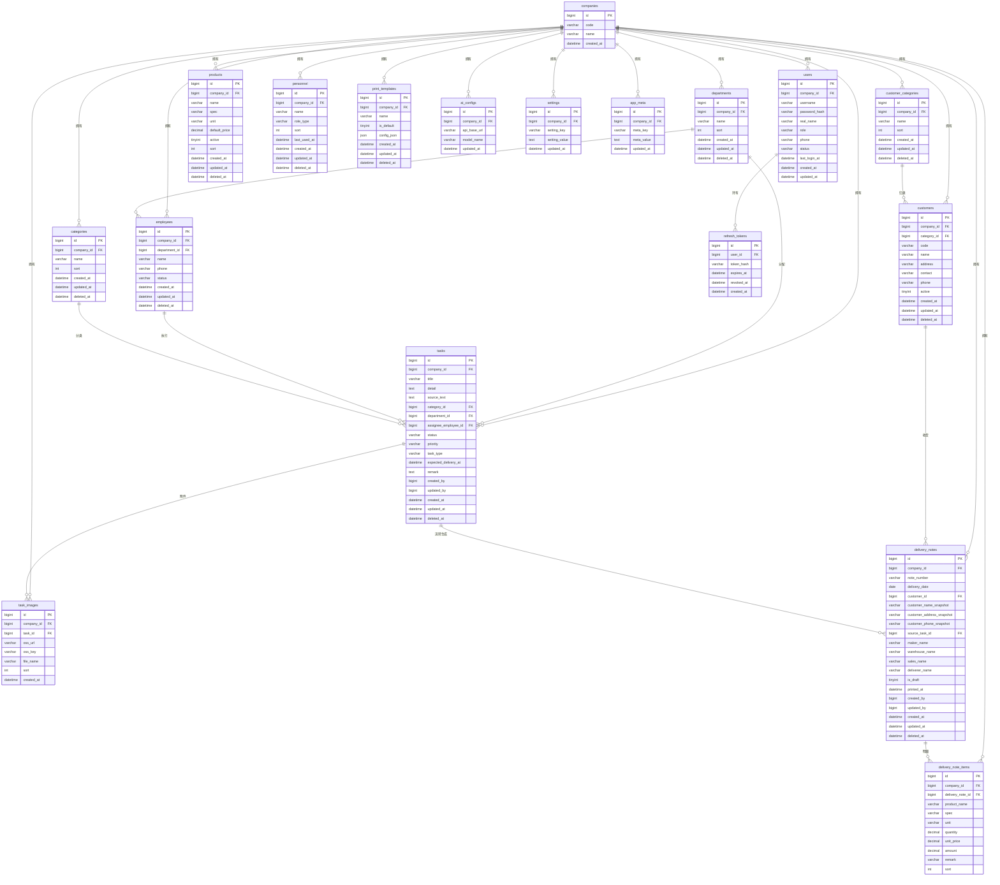

# 云端数据库设计文档

文档版本：1.0；基准日期：2026-09-22；数据库：MySQL 8.0，字符集 utf8mb4，引擎 InnoDB。

配套文档：[系统总体架构与部署文档](00-系统总体架构与部署文档.md)。

---

## 1. 设计原则

### 1.1 多公司隔离（company_id）

所有业务表（除 `companies`、`refresh_tokens` 外）必须包含 `company_id` 字段，类型 `BIGINT UNSIGNED NOT NULL`，关联 `companies.id`。所有查询必须携带 `company_id` 条件，由后端 Service 层从 JWT 载荷中注入，禁止前端传参指定 `company_id`。数据插入时 `company_id` 从当前登录用户上下文获取，不接受请求体中的 `company_id`。

### 1.2 多用户（user_id）

系统引入完整的用户账号体系（替代原任务 App 的单启动密码和送货单 App 的无账号）。所有业务表包含审计字段 `created_by`、`updated_by`，类型 `BIGINT UNSIGNED`，关联 `users.id`，记录创建人和最后修改人。

### 1.3 软删除（deleted_at）

所有业务表（除 `refresh_tokens`、`app_meta`、`task_images` 外）包含 `deleted_at` 字段，类型 `DATETIME NULL DEFAULT NULL`。删除操作执行 `UPDATE ... SET deleted_at = NOW()` 而非物理删除，查询时默认追加 `WHERE deleted_at IS NULL`。`task_images` 采用物理删除（图片文件从 OSS 删除后记录无保留意义），`refresh_tokens` 采用 `revoked_at` 标记撤销而非 `deleted_at`。

### 1.4 审计字段

所有业务表包含以下审计字段：

| 字段 | 类型 | 默认值 | 说明 |
|---|---|---|---|
| `created_by` | BIGINT UNSIGNED | NULL | 创建人用户 ID，关联 users.id |
| `updated_by` | BIGINT UNSIGNED | NULL | 最后修改人用户 ID |
| `created_at` | DATETIME | CURRENT_TIMESTAMP | 创建时间 |
| `updated_at` | DATETIME | CURRENT_TIMESTAMP ON UPDATE CURRENT_TIMESTAMP | 最后更新时间 |

时间统一存储北京时间（UTC+8），MySQL 会话时区设置为 `+08:00`。

### 1.5 字符集与引擎

- 数据库默认字符集：`utf8mb4`，排序规则 `utf8mb4_unicode_ci`（支持 emoji 和所有 Unicode 字符，不区分大小写）。
- 所有表引擎：`InnoDB`（支持事务、行级锁、外键）。
- 所有 `TEXT`/`VARCHAR` 字段显式指定 `CHARACTER SET utf8mb4 COLLATE utf8mb4_unicode_ci`。
- 金额字段使用 `DECIMAL(12,2)` 而非 `FLOAT`/`DOUBLE`，避免浮点精度问题（原送货单 App 使用普通浮点数，上云后升级为定点数）。

### 1.6 逻辑外键

不使用 MySQL `FOREIGN KEY CONSTRAINT` 强制外键约束，所有关联通过应用层（Service/Repository）校验保证完整性。原因：
- 软删除场景下，物理外键会阻止删除被引用的记录（如删除有任务的部门），而业务需要保留历史关联。
- 数据迁移时 ID 重新生成，物理外键会增加迁移复杂度。
- 任务删除后送货单需保留（`source_task_id` 可指向已删除任务），物理外键不允许。

关联字段命名规范：`<关联表名单数>_id`，如 `company_id`、`user_id`、`department_id`、`customer_id`、`source_task_id`。

### 1.7 主键策略

所有表主键统一为 `id BIGINT UNSIGNED NOT NULL AUTO_INCREMENT PRIMARY KEY`。原送货单 App 使用 TEXT UUID 主键、原任务 App 使用 INTEGER 自增主键，迁移时统一重新生成自增 ID，迁移脚本维护旧 ID → 新 ID 映射表用于外键关联。

---

## 2. ER 图



---

## 3. 完整表结构

### 3.1 companies（公司表）

| 字段名 | 类型 | 是否NULL | 默认值 | 注释 | 索引 |
|---|---|---|---|---|---|
| id | BIGINT UNSIGNED | NOT NULL | AUTO_INCREMENT | 主键 | PRIMARY KEY |
| code | VARCHAR(20) | NOT NULL | - | 公司代码，`tri`（趣趣特）/ `tmy`（天美意），未来可扩展 | UNIQUE KEY `uk_code` |
| name | VARCHAR(100) | NOT NULL | - | 公司全称，如"深圳市趣趣特食品有限公司" | - |
| short_name | VARCHAR(50) | NOT NULL | - | 公司简称，如"趣趣特"，用于打印抬头 | - |
| address | VARCHAR(255) | NULL | NULL | 公司地址，用于打印 | - |
| phone | VARCHAR(30) | NULL | NULL | 公司电话，用于打印 | - |
| created_at | DATETIME | NOT NULL | CURRENT_TIMESTAMP | 创建时间 | - |
| updated_at | DATETIME | NOT NULL | CURRENT_TIMESTAMP ON UPDATE CURRENT_TIMESTAMP | 更新时间 | - |

**建表 SQL：**

```sql
CREATE TABLE `companies` (
  `id` BIGINT UNSIGNED NOT NULL AUTO_INCREMENT,
  `code` VARCHAR(20) NOT NULL COMMENT '公司代码 tri/tmy',
  `name` VARCHAR(100) NOT NULL COMMENT '公司全称',
  `short_name` VARCHAR(50) NOT NULL COMMENT '公司简称',
  `address` VARCHAR(255) NULL DEFAULT NULL COMMENT '公司地址',
  `phone` VARCHAR(30) NULL DEFAULT NULL COMMENT '公司电话',
  `created_at` DATETIME NOT NULL DEFAULT CURRENT_TIMESTAMP,
  `updated_at` DATETIME NOT NULL DEFAULT CURRENT_TIMESTAMP ON UPDATE CURRENT_TIMESTAMP,
  PRIMARY KEY (`id`),
  UNIQUE KEY `uk_code` (`code`)
) ENGINE=InnoDB DEFAULT CHARSET=utf8mb4 COLLATE=utf8mb4_unicode_ci COMMENT='公司表';

-- 初始数据
INSERT INTO `companies` (`code`, `name`, `short_name`) VALUES
('tri', '深圳市趣趣特食品有限公司', '趣趣特'),
('tmy', '深圳市天美意食品有限公司', '天美意');
```

### 3.2 users（用户表）

| 字段名 | 类型 | 是否NULL | 默认值 | 注释 | 索引 |
|---|---|---|---|---|---|
| id | BIGINT UNSIGNED | NOT NULL | AUTO_INCREMENT | 主键 | PRIMARY KEY |
| company_id | BIGINT UNSIGNED | NOT NULL | - | 所属公司 ID | KEY `idx_company_id` |
| username | VARCHAR(50) | NOT NULL | - | 登录用户名，公司内唯一 | UNIQUE KEY `uk_company_username` (company_id, username) |
| password_hash | VARCHAR(255) | NOT NULL | - | bcrypt 密码哈希（cost=12），不存明文 | - |
| real_name | VARCHAR(50) | NOT NULL | - | 真实姓名 | - |
| role | VARCHAR(20) | NOT NULL | 'employee' | 角色：`boss`（老板）/ `admin`（管理员）/ `employee`（普通员工） | KEY `idx_role` |
| phone | VARCHAR(30) | NULL | NULL | 手机号 | - |
| status | VARCHAR(20) | NOT NULL | 'active' | 状态：`active`（启用）/ `disabled`（禁用） | - |
| last_login_at | DATETIME | NULL | NULL | 最后登录时间 | - |
| created_by | BIGINT UNSIGNED | NULL | NULL | 创建人用户 ID | - |
| updated_by | BIGINT UNSIGNED | NULL | NULL | 最后修改人 | - |
| created_at | DATETIME | NOT NULL | CURRENT_TIMESTAMP | 创建时间 | - |
| updated_at | DATETIME | NOT NULL | CURRENT_TIMESTAMP ON UPDATE CURRENT_TIMESTAMP | 更新时间 | - |
| deleted_at | DATETIME | NULL | NULL | 软删除时间 | - |

**说明：**
- 原任务 App 的启动密码（scrypt 哈希）升级为完整账号密码体系。迁移时为每家公司创建一个默认 `admin` 用户，用户名 `admin`，密码需首次登录后重置（设置临时密码并强制修改）。
- 原送货单 App 无账号系统，迁移时同样创建默认 `admin` 用户。
- `password_hash` 使用 bcrypt 而非原任务 App 的 scrypt，因为 bcrypt 是 Node.js 生态最成熟的密码哈希方案（`bcryptjs` 或 `@node-rs/bcrypt`），NestJS 官方 `@nestjs/passport` 文档推荐。
- `role` 为 `boss` 的用户可查看所有部门任务、管理所有用户；`admin` 可管理基础资料和用户；`employee` 仅可查看和操作分配给自己的任务（第一期可简化为所有登录用户可见全公司任务，权限细化后续迭代）。

**建表 SQL：**

```sql
CREATE TABLE `users` (
  `id` BIGINT UNSIGNED NOT NULL AUTO_INCREMENT,
  `company_id` BIGINT UNSIGNED NOT NULL,
  `username` VARCHAR(50) NOT NULL,
  `password_hash` VARCHAR(255) NOT NULL,
  `real_name` VARCHAR(50) NOT NULL,
  `role` VARCHAR(20) NOT NULL DEFAULT 'employee' COMMENT 'boss/admin/employee',
  `phone` VARCHAR(30) NULL DEFAULT NULL,
  `status` VARCHAR(20) NOT NULL DEFAULT 'active' COMMENT 'active/disabled',
  `last_login_at` DATETIME NULL DEFAULT NULL,
  `created_by` BIGINT UNSIGNED NULL DEFAULT NULL,
  `updated_by` BIGINT UNSIGNED NULL DEFAULT NULL,
  `created_at` DATETIME NOT NULL DEFAULT CURRENT_TIMESTAMP,
  `updated_at` DATETIME NOT NULL DEFAULT CURRENT_TIMESTAMP ON UPDATE CURRENT_TIMESTAMP,
  `deleted_at` DATETIME NULL DEFAULT NULL,
  PRIMARY KEY (`id`),
  UNIQUE KEY `uk_company_username` (`company_id`, `username`),
  KEY `idx_company_id` (`company_id`),
  KEY `idx_role` (`role`)
) ENGINE=InnoDB DEFAULT CHARSET=utf8mb4 COLLATE=utf8mb4_unicode_ci COMMENT='用户表';
```

### 3.3 departments（部门表）

| 字段名 | 类型 | 是否NULL | 默认值 | 注释 | 索引 |
|---|---|---|---|---|---|
| id | BIGINT UNSIGNED | NOT NULL | AUTO_INCREMENT | 主键 | PRIMARY KEY |
| company_id | BIGINT UNSIGNED | NOT NULL | - | 所属公司 ID | KEY `idx_company_id`，联合唯一索引一部分 |
| name | VARCHAR(50) | NOT NULL | - | 部门名称，如"蛋糕部""面包部""制面部" | UNIQUE KEY `uk_company_name` (company_id, name) WHERE deleted_at IS NULL（应用层保证，MySQL 不支持部分唯一索引，用普通唯一索引+软删除时改名加后缀处理） |
| sort | INT | NOT NULL | 0 | 排序号，越小越靠前 | - |
| created_by | BIGINT UNSIGNED | NULL | NULL | 创建人 | - |
| updated_by | BIGINT UNSIGNED | NULL | NULL | 最后修改人 | - |
| created_at | DATETIME | NOT NULL | CURRENT_TIMESTAMP | 创建时间 | - |
| updated_at | DATETIME | NOT NULL | CURRENT_TIMESTAMP ON UPDATE CURRENT_TIMESTAMP | 更新时间 | - |
| deleted_at | DATETIME | NULL | NULL | 软删除时间 | KEY `idx_deleted_at` |

**说明：**
- 原任务 App `departments` 表 `name` 为全表唯一（`TEXT NOT NULL UNIQUE`），上云后改为公司内唯一（`company_id + name`），支持不同公司同名部门。
- 初始部门：蛋糕部、面包部、制面部（每家公司独立初始化）。
- 删除保护：存在任意非取消状态（`status != 'canceled'`）任务关联时不可删除。删除部门同步逻辑删除其下所有员工（`employees.deleted_at = NOW()`）。

**建表 SQL：**

```sql
CREATE TABLE `departments` (
  `id` BIGINT UNSIGNED NOT NULL AUTO_INCREMENT,
  `company_id` BIGINT UNSIGNED NOT NULL,
  `name` VARCHAR(50) NOT NULL,
  `sort` INT NOT NULL DEFAULT 0,
  `created_by` BIGINT UNSIGNED NULL DEFAULT NULL,
  `updated_by` BIGINT UNSIGNED NULL DEFAULT NULL,
  `created_at` DATETIME NOT NULL DEFAULT CURRENT_TIMESTAMP,
  `updated_at` DATETIME NOT NULL DEFAULT CURRENT_TIMESTAMP ON UPDATE CURRENT_TIMESTAMP,
  `deleted_at` DATETIME NULL DEFAULT NULL,
  PRIMARY KEY (`id`),
  UNIQUE KEY `uk_company_name` (`company_id`, `name`),
  KEY `idx_company_id` (`company_id`)
) ENGINE=InnoDB DEFAULT CHARSET=utf8mb4 COLLATE=utf8mb4_unicode_ci COMMENT='部门表';
```

### 3.4 employees（员工表）

| 字段名 | 类型 | 是否NULL | 默认值 | 注释 | 索引 |
|---|---|---|---|---|---|
| id | BIGINT UNSIGNED | NOT NULL | AUTO_INCREMENT | 主键 | PRIMARY KEY |
| company_id | BIGINT UNSIGNED | NOT NULL | - | 所属公司 ID | KEY `idx_company_id` |
| department_id | BIGINT UNSIGNED | NOT NULL | - | 所属部门 ID | KEY `idx_department_id` |
| name | VARCHAR(50) | NOT NULL | - | 员工姓名 | KEY `idx_company_name` (company_id, name) |
| phone | VARCHAR(30) | NULL | NULL | 手机号 | - |
| status | VARCHAR(20) | NOT NULL | 'active' | 状态：`active`（在职）/ `left`（离职） | KEY `idx_status` |
| created_by | BIGINT UNSIGNED | NULL | NULL | 创建人 | - |
| updated_by | BIGINT UNSIGNED | NULL | NULL | 最后修改人 | - |
| created_at | DATETIME | NOT NULL | CURRENT_TIMESTAMP | 创建时间 | - |
| updated_at | DATETIME | NOT NULL | CURRENT_TIMESTAMP ON UPDATE CURRENT_TIMESTAMP | 更新时间 | - |
| deleted_at | DATETIME | NULL | NULL | 软删除时间 | - |

**说明：**
- 原任务 App `employees` 表使用 `active INTEGER` 表示在职状态，上云后改为 `status VARCHAR` 枚举（`active`/`left`），语义更清晰。
- **与 `users` 表的关系**：员工不一定有登录账号。`employees` 是业务执行人池，任务分配时从 `employees` 选择执行人（`assignee_employee_id`）；`users` 是系统登录账号。两者通过 `real_name` 或 `phone` 可人工关联，但数据库层面不强制外键。一个 `users` 记录可对应一个 `employees` 记录（如员工本人登录查看自己的任务），但第一期不做自动关联。
- 删除保护：存在任意非取消状态任务关联时不可删除；有非取消任务时不可调往其他部门。
- 离职（`status='left'`）员工不出现在新任务分配列表中，但历史任务继续显示原关联姓名。

**建表 SQL：**

```sql
CREATE TABLE `employees` (
  `id` BIGINT UNSIGNED NOT NULL AUTO_INCREMENT,
  `company_id` BIGINT UNSIGNED NOT NULL,
  `department_id` BIGINT UNSIGNED NOT NULL,
  `name` VARCHAR(50) NOT NULL,
  `phone` VARCHAR(30) NULL DEFAULT NULL,
  `status` VARCHAR(20) NOT NULL DEFAULT 'active' COMMENT 'active/left',
  `created_by` BIGINT UNSIGNED NULL DEFAULT NULL,
  `updated_by` BIGINT UNSIGNED NULL DEFAULT NULL,
  `created_at` DATETIME NOT NULL DEFAULT CURRENT_TIMESTAMP,
  `updated_at` DATETIME NOT NULL DEFAULT CURRENT_TIMESTAMP ON UPDATE CURRENT_TIMESTAMP,
  `deleted_at` DATETIME NULL DEFAULT NULL,
  PRIMARY KEY (`id`),
  KEY `idx_company_id` (`company_id`),
  KEY `idx_department_id` (`department_id`),
  KEY `idx_company_name` (`company_id`, `name`),
  KEY `idx_status` (`status`)
) ENGINE=InnoDB DEFAULT CHARSET=utf8mb4 COLLATE=utf8mb4_unicode_ci COMMENT='员工表';
```

### 3.5 categories（业务分类表）

| 字段名 | 类型 | 是否NULL | 默认值 | 注释 | 索引 |
|---|---|---|---|---|---|
| id | BIGINT UNSIGNED | NOT NULL | AUTO_INCREMENT | 主键 | PRIMARY KEY |
| company_id | BIGINT UNSIGNED | NOT NULL | - | 所属公司 ID | KEY `idx_company_id` |
| name | VARCHAR(50) | NOT NULL | - | 分类名称，如"定制蛋糕""茶歇""门店供应配送" | UNIQUE KEY `uk_company_name` (company_id, name) |
| sort | INT | NOT NULL | 0 | 排序号 | - |
| created_by | BIGINT UNSIGNED | NULL | NULL | 创建人 | - |
| updated_by | BIGINT UNSIGNED | NULL | NULL | 最后修改人 | - |
| created_at | DATETIME | NOT NULL | CURRENT_TIMESTAMP | 创建时间 | - |
| updated_at | DATETIME | NOT NULL | CURRENT_TIMESTAMP ON UPDATE CURRENT_TIMESTAMP | 更新时间 | - |
| deleted_at | DATETIME | NULL | NULL | 软删除时间（停用式删除） | - |

**说明：**
- 原任务 App `categories` 表使用局部唯一索引（`WHERE deleted_at IS NULL`），允许删除后新建同名分类。MySQL 不支持部分唯一索引，上云后使用普通唯一索引 `(company_id, name)`，软删除时如需重用名称，应用层将已删除记录的 name 追加 `_deleted_<id>` 后缀。
- 初始分类：定制蛋糕、茶歇、门店供应配送（每家公司独立初始化）。
- 删除为停用式：不再出现在新任务选择项，但历史任务保留原 `category_id` 关联，不批量删除任务。
- "未分类"不是数据库中的分类记录，`tasks.category_id IS NULL` 表示未分类。

**建表 SQL：**

```sql
CREATE TABLE `categories` (
  `id` BIGINT UNSIGNED NOT NULL AUTO_INCREMENT,
  `company_id` BIGINT UNSIGNED NOT NULL,
  `name` VARCHAR(50) NOT NULL,
  `sort` INT NOT NULL DEFAULT 0,
  `created_by` BIGINT UNSIGNED NULL DEFAULT NULL,
  `updated_by` BIGINT UNSIGNED NULL DEFAULT NULL,
  `created_at` DATETIME NOT NULL DEFAULT CURRENT_TIMESTAMP,
  `updated_at` DATETIME NOT NULL DEFAULT CURRENT_TIMESTAMP ON UPDATE CURRENT_TIMESTAMP,
  `deleted_at` DATETIME NULL DEFAULT NULL,
  PRIMARY KEY (`id`),
  UNIQUE KEY `uk_company_name` (`company_id`, `name`),
  KEY `idx_company_id` (`company_id`)
) ENGINE=InnoDB DEFAULT CHARSET=utf8mb4 COLLATE=utf8mb4_unicode_ci COMMENT='业务分类表';
```

### 3.6 customer_categories（客户分类表）

| 字段名 | 类型 | 是否NULL | 默认值 | 注释 | 索引 |
|---|---|---|---|---|---|
| id | BIGINT UNSIGNED | NOT NULL | AUTO_INCREMENT | 主键 | PRIMARY KEY |
| company_id | BIGINT UNSIGNED | NOT NULL | - | 所属公司 ID | KEY `idx_company_id` |
| name | VARCHAR(50) | NOT NULL | - | 分类名称 | UNIQUE KEY `uk_company_name` (company_id, name) |
| sort | INT | NOT NULL | 0 | 排序号 | - |
| created_by | BIGINT UNSIGNED | NULL | NULL | 创建人 | - |
| updated_by | BIGINT UNSIGNED | NULL | NULL | 最后修改人 | - |
| created_at | DATETIME | NOT NULL | CURRENT_TIMESTAMP | 创建时间 | - |
| updated_at | DATETIME | NOT NULL | CURRENT_TIMESTAMP ON UPDATE CURRENT_TIMESTAMP | 更新时间 | - |
| deleted_at | DATETIME | NULL | NULL | 软删除时间 | - |

**说明：**
- 原送货单 App `customer_categories` 表字段：`id TEXT PK, company_id, name, created_at, updated_at, active INTEGER DEFAULT 1, UNIQUE(company_id, name)`。上云后统一为自增 ID + 软删除模式，移除 `active` 字段（用 `deleted_at` 替代）。
- "未分类"为保留分类，不允许重命名或删除。初始化时为每家公司创建一条 `name='未分类'` 的记录。
- 有有效客户使用的分类不能删除；无客户使用的普通分类可以删除。
- 按客户分类汇总采用客户当前分类（`customers.category_id`），不是开单时的历史分类快照。

**建表 SQL：**

```sql
CREATE TABLE `customer_categories` (
  `id` BIGINT UNSIGNED NOT NULL AUTO_INCREMENT,
  `company_id` BIGINT UNSIGNED NOT NULL,
  `name` VARCHAR(50) NOT NULL,
  `sort` INT NOT NULL DEFAULT 0,
  `created_by` BIGINT UNSIGNED NULL DEFAULT NULL,
  `updated_by` BIGINT UNSIGNED NULL DEFAULT NULL,
  `created_at` DATETIME NOT NULL DEFAULT CURRENT_TIMESTAMP,
  `updated_at` DATETIME NOT NULL DEFAULT CURRENT_TIMESTAMP ON UPDATE CURRENT_TIMESTAMP,
  `deleted_at` DATETIME NULL DEFAULT NULL,
  PRIMARY KEY (`id`),
  UNIQUE KEY `uk_company_name` (`company_id`, `name`),
  KEY `idx_company_id` (`company_id`)
) ENGINE=InnoDB DEFAULT CHARSET=utf8mb4 COLLATE=utf8mb4_unicode_ci COMMENT='客户分类表';
```

### 3.7 customers（客户表）

| 字段名 | 类型 | 是否NULL | 默认值 | 注释 | 索引 |
|---|---|---|---|---|---|
| id | BIGINT UNSIGNED | NOT NULL | AUTO_INCREMENT | 主键 | PRIMARY KEY |
| company_id | BIGINT UNSIGNED | NOT NULL | - | 所属公司 ID | KEY `idx_company_id` |
| code | VARCHAR(50) | NULL | NULL | 客户编码 | - |
| name | VARCHAR(100) | NOT NULL | - | 客户名称 | UNIQUE KEY `uk_company_name` (company_id, name) |
| address | VARCHAR(255) | NULL | NULL | 客户地址 | - |
| contact | VARCHAR(50) | NULL | NULL | 联系人 | - |
| phone | VARCHAR(30) | NULL | NULL | 联系电话 | - |
| category_id | BIGINT UNSIGNED | NULL | NULL | 客户分类 ID，关联 customer_categories.id，NULL 表示未分类 | KEY `idx_category_id` |
| active | TINYINT(1) | NOT NULL | 1 | 是否有效（1=有效，0=停用） | - |
| created_by | BIGINT UNSIGNED | NULL | NULL | 创建人 | - |
| updated_by | BIGINT UNSIGNED | NULL | NULL | 最后修改人 | - |
| created_at | DATETIME | NOT NULL | CURRENT_TIMESTAMP | 创建时间 | - |
| updated_at | DATETIME | NOT NULL | CURRENT_TIMESTAMP ON UPDATE CURRENT_TIMESTAMP | 更新时间 | - |
| deleted_at | DATETIME | NULL | NULL | 软删除时间 | - |

**说明：**
- 原送货单 App `customers` 表字段：`id TEXT PK, company_id, name NOT NULL, code/address/contact/phone 可空, category 默认'未分类', active INTEGER DEFAULT 1, updated_at, UNIQUE(company_id, name)`。上云后 `category` 从字符串改为 `category_id` 外键关联 `customer_categories` 表。
- 同一客户名称允许在不同公司分别维护（`UNIQUE(company_id, name)`）。
- 送货单保存时，客户名称、地址、电话会快照到 `delivery_notes` 表（`customer_name_snapshot` 等），历史送货单不因客户资料变更而改写。

**建表 SQL：**

```sql
CREATE TABLE `customers` (
  `id` BIGINT UNSIGNED NOT NULL AUTO_INCREMENT,
  `company_id` BIGINT UNSIGNED NOT NULL,
  `code` VARCHAR(50) NULL DEFAULT NULL,
  `name` VARCHAR(100) NOT NULL,
  `address` VARCHAR(255) NULL DEFAULT NULL,
  `contact` VARCHAR(50) NULL DEFAULT NULL,
  `phone` VARCHAR(30) NULL DEFAULT NULL,
  `category_id` BIGINT UNSIGNED NULL DEFAULT NULL,
  `active` TINYINT(1) NOT NULL DEFAULT 1,
  `created_by` BIGINT UNSIGNED NULL DEFAULT NULL,
  `updated_by` BIGINT UNSIGNED NULL DEFAULT NULL,
  `created_at` DATETIME NOT NULL DEFAULT CURRENT_TIMESTAMP,
  `updated_at` DATETIME NOT NULL DEFAULT CURRENT_TIMESTAMP ON UPDATE CURRENT_TIMESTAMP,
  `deleted_at` DATETIME NULL DEFAULT NULL,
  PRIMARY KEY (`id`),
  UNIQUE KEY `uk_company_name` (`company_id`, `name`),
  KEY `idx_company_id` (`company_id`),
  KEY `idx_category_id` (`category_id`)
) ENGINE=InnoDB DEFAULT CHARSET=utf8mb4 COLLATE=utf8mb4_unicode_ci COMMENT='客户表';
```

### 3.8 products（产品表）

| 字段名 | 类型 | 是否NULL | 默认值 | 注释 | 索引 |
|---|---|---|---|---|---|
| id | BIGINT UNSIGNED | NOT NULL | AUTO_INCREMENT | 主键 | PRIMARY KEY |
| company_id | BIGINT UNSIGNED | NOT NULL | - | 所属公司 ID | KEY `idx_company_id` |
| name | VARCHAR(100) | NOT NULL | - | 产品名称 | UNIQUE KEY `uk_company_name_spec` (company_id, name, spec) |
| spec | VARCHAR(100) | NOT NULL | '' | 规格/型号 | 联合唯一索引一部分 |
| unit | VARCHAR(20) | NOT NULL | - | 单位，如"个""盒""份" | - |
| default_price | DECIMAL(12,2) | NOT NULL | 0.00 | 默认单价，仅作下次录入参考 | - |
| active | TINYINT(1) | NOT NULL | 1 | 是否有效 | - |
| sort | INT | NOT NULL | 0 | 排序号 | - |
| created_by | BIGINT UNSIGNED | NULL | NULL | 创建人 | - |
| updated_by | BIGINT UNSIGNED | NULL | NULL | 最后修改人 | - |
| created_at | DATETIME | NOT NULL | CURRENT_TIMESTAMP | 创建时间 | - |
| updated_at | DATETIME | NOT NULL | CURRENT_TIMESTAMP ON UPDATE CURRENT_TIMESTAMP | 更新时间 | - |
| deleted_at | DATETIME | NULL | NULL | 软删除时间 | - |

**说明：**
- 原送货单 App `products` 表字段：`id TEXT PK, company_id, name, unit NOT NULL, specification DEFAULT '', default_price REAL DEFAULT 0, active INTEGER DEFAULT 1, updated_at, UNIQUE(company_id, name, specification)`。上云后 `specification` 重命名为 `spec`，`default_price` 从 `REAL` 改为 `DECIMAL(12,2)`。
- 同公司产品按名称和规格组合匹配（`UNIQUE(company_id, name, spec)`）。
- 默认价格只是下次录入的参考，不回写历史送货单单价。

**建表 SQL：**

```sql
CREATE TABLE `products` (
  `id` BIGINT UNSIGNED NOT NULL AUTO_INCREMENT,
  `company_id` BIGINT UNSIGNED NOT NULL,
  `name` VARCHAR(100) NOT NULL,
  `spec` VARCHAR(100) NOT NULL DEFAULT '',
  `unit` VARCHAR(20) NOT NULL,
  `default_price` DECIMAL(12,2) NOT NULL DEFAULT 0.00,
  `active` TINYINT(1) NOT NULL DEFAULT 1,
  `sort` INT NOT NULL DEFAULT 0,
  `created_by` BIGINT UNSIGNED NULL DEFAULT NULL,
  `updated_by` BIGINT UNSIGNED NULL DEFAULT NULL,
  `created_at` DATETIME NOT NULL DEFAULT CURRENT_TIMESTAMP,
  `updated_at` DATETIME NOT NULL DEFAULT CURRENT_TIMESTAMP ON UPDATE CURRENT_TIMESTAMP,
  `deleted_at` DATETIME NULL DEFAULT NULL,
  PRIMARY KEY (`id`),
  UNIQUE KEY `uk_company_name_spec` (`company_id`, `name`, `spec`),
  KEY `idx_company_id` (`company_id`)
) ENGINE=InnoDB DEFAULT CHARSET=utf8mb4 COLLATE=utf8mb4_unicode_ci COMMENT='产品表';
```

### 3.9 personnel（人员表，署名池）

| 字段名 | 类型 | 是否NULL | 默认值 | 注释 | 索引 |
|---|---|---|---|---|---|
| id | BIGINT UNSIGNED | NOT NULL | AUTO_INCREMENT | 主键 | PRIMARY KEY |
| company_id | BIGINT UNSIGNED | NOT NULL | - | 所属公司 ID | KEY `idx_company_id` |
| name | VARCHAR(50) | NOT NULL | - | 人员姓名 | UNIQUE KEY `uk_company_name` (company_id, name) |
| role_type | VARCHAR(20) | NOT NULL | 'general' | 角色类型：`maker`（制单）/ `warehouse`（仓管）/ `sales`（业务）/ `deliverer`（送货人）/ `general`（通用，可用于任意栏位） | KEY `idx_role_type` |
| sort | INT | NOT NULL | 0 | 排序号 | - |
| last_used_at | DATETIME | NULL | NULL | 最近使用时间，用于排序推荐 | - |
| created_by | BIGINT UNSIGNED | NULL | NULL | 创建人 | - |
| updated_by | BIGINT UNSIGNED | NULL | NULL | 最后修改人 | - |
| created_at | DATETIME | NOT NULL | CURRENT_TIMESTAMP | 创建时间 | - |
| updated_at | DATETIME | NOT NULL | CURRENT_TIMESTAMP ON UPDATE CURRENT_TIMESTAMP | 更新时间 | - |
| deleted_at | DATETIME | NULL | NULL | 软删除时间 | - |

**说明：**
- 原送货单 App `personnel` 表字段：`id TEXT PK, company_id, name, created_at, updated_at, active INTEGER DEFAULT 1, last_used_at, UNIQUE(company_id, name)`。原设计是一个人员池供四个署名栏（制单/仓管/业务/送货人）共用。上云后增加 `role_type` 字段，允许按角色分类筛选，但仍保留 `general` 类型可用于任意栏位（兼容原设计）。
- 人员不是系统用户（`users`），没有登录权限和组织部门概念。删除人员不修改历史送货单署名。
- 保存送货单时，新录入的姓名会自动补充到人员池（upsert），并更新 `last_used_at`。

**建表 SQL：**

```sql
CREATE TABLE `personnel` (
  `id` BIGINT UNSIGNED NOT NULL AUTO_INCREMENT,
  `company_id` BIGINT UNSIGNED NOT NULL,
  `name` VARCHAR(50) NOT NULL,
  `role_type` VARCHAR(20) NOT NULL DEFAULT 'general' COMMENT 'maker/warehouse/sales/deliverer/general',
  `sort` INT NOT NULL DEFAULT 0,
  `last_used_at` DATETIME NULL DEFAULT NULL,
  `created_by` BIGINT UNSIGNED NULL DEFAULT NULL,
  `updated_by` BIGINT UNSIGNED NULL DEFAULT NULL,
  `created_at` DATETIME NOT NULL DEFAULT CURRENT_TIMESTAMP,
  `updated_at` DATETIME NOT NULL DEFAULT CURRENT_TIMESTAMP ON UPDATE CURRENT_TIMESTAMP,
  `deleted_at` DATETIME NULL DEFAULT NULL,
  PRIMARY KEY (`id`),
  UNIQUE KEY `uk_company_name` (`company_id`, `name`),
  KEY `idx_company_id` (`company_id`),
  KEY `idx_role_type` (`role_type`)
) ENGINE=InnoDB DEFAULT CHARSET=utf8mb4 COLLATE=utf8mb4_unicode_ci COMMENT='人员表（署名池）';

### 3.10 tasks（任务表）

| 字段名 | 类型 | 是否NULL | 默认值 | 注释 | 索引 |
|---|---|---|---|---|---|
| id | BIGINT UNSIGNED | NOT NULL | AUTO_INCREMENT | 主键 | PRIMARY KEY |
| company_id | BIGINT UNSIGNED | NOT NULL | - | 所属公司 ID | 联合索引一部分 |
| title | VARCHAR(200) | NOT NULL | - | 任务标题，必填，≤200 字符 | - |
| detail | TEXT | NULL | NULL | 任务详情（产品、数量、地址、要求等文本） | - |
| source_text | TEXT | NULL | NULL | 消息原文（AI 来源文本保留，便于核对） | - |
| category_id | BIGINT UNSIGNED | NULL | NULL | 业务分类 ID，关联 categories.id，NULL 表示未分类 | KEY `idx_category_id` |
| department_id | BIGINT UNSIGNED | NOT NULL | - | 负责部门 ID，关联 departments.id | 联合索引一部分 |
| assignee_employee_id | BIGINT UNSIGNED | NOT NULL | - | 执行人员工 ID，关联 employees.id | 联合索引一部分 |
| status | VARCHAR(20) | NOT NULL | 'todo' | 任务状态：todo/doing/waiting_ship/shipped/delivered/canceled | 联合索引一部分 |
| priority | VARCHAR(20) | NOT NULL | 'normal' | 优先级：low/normal/high/urgent | - |
| task_type | VARCHAR(20) | NOT NULL | - | 任务类型：order（订单）/production（生产）/shipping（发货）/change（变更） | - |
| expected_delivery_at | DATETIME | NULL | NULL | 预计交付时间，精确到分钟；为空表示时间待补充 | KEY `idx_expected_delivery_at` |
| remark | TEXT | NULL | NULL | 备注（特殊要求、不完整时间说明等） | - |
| created_by | BIGINT UNSIGNED | NULL | NULL | 创建人用户 ID | - |
| updated_by | BIGINT UNSIGNED | NULL | NULL | 最后修改人 | - |
| created_at | DATETIME | NOT NULL | CURRENT_TIMESTAMP | 创建时间 | KEY `idx_created_at` |
| updated_at | DATETIME | NOT NULL | CURRENT_TIMESTAMP ON UPDATE CURRENT_TIMESTAMP | 更新时间 | - |
| deleted_at | DATETIME | NULL | NULL | 软删除时间 | - |

**索引说明：**

| 索引名 | 字段 | 用途 |
|---|---|---|
| PRIMARY | id | 主键 |
| idx_company_status | company_id, status | 按公司+状态筛选任务（列表/看板/概览计数） |
| idx_company_department | company_id, department_id | 按公司+部门筛选任务 |
| idx_company_assignee | company_id, assignee_employee_id | 按公司+执行人筛选任务 |
| idx_expected_delivery_at | expected_delivery_at | 按预计交付时间范围筛选、月份归属计算 |
| idx_created_at | created_at | 按创建时间排序、月份归属兜底 |
| idx_category_id | category_id | 按业务分类筛选 |

**建表 SQL：**

```sql
CREATE TABLE `tasks` (
  `id` BIGINT UNSIGNED NOT NULL AUTO_INCREMENT,
  `company_id` BIGINT UNSIGNED NOT NULL,
  `title` VARCHAR(200) NOT NULL,
  `detail` TEXT NULL DEFAULT NULL,
  `source_text` TEXT NULL DEFAULT NULL,
  `category_id` BIGINT UNSIGNED NULL DEFAULT NULL,
  `department_id` BIGINT UNSIGNED NOT NULL,
  `assignee_employee_id` BIGINT UNSIGNED NOT NULL,
  `status` VARCHAR(20) NOT NULL DEFAULT 'todo',
  `priority` VARCHAR(20) NOT NULL DEFAULT 'normal',
  `task_type` VARCHAR(20) NOT NULL,
  `expected_delivery_at` DATETIME NULL DEFAULT NULL,
  `remark` TEXT NULL DEFAULT NULL,
  `created_by` BIGINT UNSIGNED NULL DEFAULT NULL,
  `updated_by` BIGINT UNSIGNED NULL DEFAULT NULL,
  `created_at` DATETIME NOT NULL DEFAULT CURRENT_TIMESTAMP,
  `updated_at` DATETIME NOT NULL DEFAULT CURRENT_TIMESTAMP ON UPDATE CURRENT_TIMESTAMP,
  `deleted_at` DATETIME NULL DEFAULT NULL,
  PRIMARY KEY (`id`),
  KEY `idx_company_status` (`company_id`, `status`),
  KEY `idx_company_department` (`company_id`, `department_id`),
  KEY `idx_company_assignee` (`company_id`, `assignee_employee_id`),
  KEY `idx_expected_delivery_at` (`expected_delivery_at`),
  KEY `idx_created_at` (`created_at`),
  KEY `idx_category_id` (`category_id`)
) ENGINE=InnoDB DEFAULT CHARSET=utf8mb4 COLLATE=utf8mb4_unicode_ci COMMENT='任务表';
```

### 3.11 task_images（任务图片表）

| 字段名 | 类型 | 是否NULL | 默认值 | 注释 | 索引 |
|---|---|---|---|---|---|
| id | BIGINT UNSIGNED | NOT NULL | AUTO_INCREMENT | 主键 | PRIMARY KEY |
| company_id | BIGINT UNSIGNED | NOT NULL | - | 所属公司 ID（冗余，便于按公司清理和查询） | KEY `idx_company_id` |
| task_id | BIGINT UNSIGNED | NOT NULL | - | 关联任务 ID，tasks.id | KEY `idx_task_id` |
| oss_url | VARCHAR(500) | NOT NULL | - | OSS 完整访问 URL（含 Bucket 域名） | - |
| oss_key | VARCHAR(500) | NOT NULL | - | OSS 对象 Key（路径），如 `tri/tasks/2026/09/uuid.png` | - |
| file_name | VARCHAR(255) | NOT NULL | - | 原始文件名（含扩展名），用于展示和下载 | - |
| file_size | INT UNSIGNED | NOT NULL | 0 | 文件大小（字节） | - |
| mime_type | VARCHAR(50) | NOT NULL | 'image/png' | MIME 类型 | - |
| sort | INT | NOT NULL | 0 | 排序号，任务内图片展示顺序 | - |
| created_at | DATETIME | NOT NULL | CURRENT_TIMESTAMP | 创建时间 | - |

**说明：**
- 原任务 App `task_images` 表字段：`id INTEGER PK, task_id INTEGER FK CASCADE, file_name TEXT, data BLOB NOT NULL (PNG), created_at`。上云后移除 `data` BLOB 字段，改为存储 OSS URL 和 Key。
- 每任务最多 12 张图片，由应用层校验（`SELECT COUNT(*) FROM task_images WHERE task_id = ?`）。
- 删除任务时物理删除关联图片记录（`DELETE FROM task_images WHERE task_id = ?`），同时调用 OSS SDK 删除对应对象。
- 不使用软删除，因为图片文件从 OSS 删除后记录无保留意义。
- 缩略图不单独存储，通过 OSS 图片处理参数实时生成（`?x-oss-process=image/resize,w_160/format,jpg`）。

**建表 SQL：**

```sql
CREATE TABLE `task_images` (
  `id` BIGINT UNSIGNED NOT NULL AUTO_INCREMENT,
  `company_id` BIGINT UNSIGNED NOT NULL,
  `task_id` BIGINT UNSIGNED NOT NULL,
  `oss_url` VARCHAR(500) NOT NULL,
  `oss_key` VARCHAR(500) NOT NULL,
  `file_name` VARCHAR(255) NOT NULL,
  `file_size` INT UNSIGNED NOT NULL DEFAULT 0,
  `mime_type` VARCHAR(50) NOT NULL DEFAULT 'image/png',
  `sort` INT NOT NULL DEFAULT 0,
  `created_at` DATETIME NOT NULL DEFAULT CURRENT_TIMESTAMP,
  PRIMARY KEY (`id`),
  KEY `idx_task_id` (`task_id`),
  KEY `idx_company_id` (`company_id`)
) ENGINE=InnoDB DEFAULT CHARSET=utf8mb4 COLLATE=utf8mb4_unicode_ci COMMENT='任务图片表';
```

### 3.12 delivery_notes（送货单表）

| 字段名 | 类型 | 是否NULL | 默认值 | 注释 | 索引 |
|---|---|---|---|---|---|
| id | BIGINT UNSIGNED | NOT NULL | AUTO_INCREMENT | 主键 | PRIMARY KEY |
| company_id | BIGINT UNSIGNED | NOT NULL | - | 所属公司 ID | 联合唯一索引一部分 |
| note_number | VARCHAR(50) | NOT NULL | - | 送货单号，公司内唯一，格式：公司前缀+YYMMDD+HHmmss+序号 | UNIQUE KEY `uk_company_note_number` (company_id, note_number) |
| delivery_date | DATE | NOT NULL | - | 送货日期（日期粒度，不是分钟级） | KEY `idx_delivery_date` |
| customer_id | BIGINT UNSIGNED | NULL | NULL | 客户 ID，关联 customers.id；手动录入新客户时为 NULL | KEY `idx_customer_id` |
| customer_name_snapshot | VARCHAR(100) | NOT NULL | - | 客户名称快照（保存时的客户名称，不因客户资料变更而改写） | - |
| customer_address_snapshot | VARCHAR(255) | NULL | NULL | 客户地址快照 | - |
| customer_phone_snapshot | VARCHAR(30) | NULL | NULL | 客户电话快照 | - |
| source_task_id | BIGINT UNSIGNED | NULL | NULL | 来源任务 ID，关联 tasks.id；从任务流转生成时填写，手动新建为 NULL | KEY `idx_source_task_id` |
| maker_name | VARCHAR(50) | NULL | NULL | 制单人姓名 | - |
| warehouse_name | VARCHAR(50) | NULL | NULL | 仓管人姓名 | - |
| sales_name | VARCHAR(50) | NULL | NULL | 业务人姓名 | - |
| deliverer_name | VARCHAR(50) | NULL | NULL | 送货人姓名 | - |
| is_draft | TINYINT(1) | NOT NULL | 0 | 是否草稿（1=草稿，0=正式单据）；从任务流转生成时为草稿，人工补全后保存为正式 | KEY `idx_is_draft` |
| total_amount | DECIMAL(12,2) | NOT NULL | 0.00 | 总金额（明细金额之和，保存时计算） | - |
| printed_at | DATETIME | NULL | NULL | 打印时间（打印提交成功后记录；NULL 表示未打印） | - |
| source_number | VARCHAR(50) | NULL | NULL | 历史来源单号（兼容历史单据，原 payload 中的 sourceNumber） | - |
| page | INT | NULL | NULL | 页码（兼容历史单据和打印所需信息） | - |
| total_pages | INT | NULL | NULL | 总页数 | - |
| created_by | BIGINT UNSIGNED | NULL | NULL | 创建人用户 ID | - |
| updated_by | BIGINT UNSIGNED | NULL | NULL | 最后修改人 | - |
| created_at | DATETIME | NOT NULL | CURRENT_TIMESTAMP | 创建时间 | - |
| updated_at | DATETIME | NOT NULL | CURRENT_TIMESTAMP ON UPDATE CURRENT_TIMESTAMP | 更新时间 | - |
| deleted_at | DATETIME | NULL | NULL | 软删除时间 | - |

**索引说明：**

| 索引名 | 字段 | 用途 |
|---|---|---|
| PRIMARY | id | 主键 |
| uk_company_note_number | company_id, note_number | 单号公司内唯一，单号查询 |
| idx_company_delivery_date | company_id, delivery_date | 按公司+日期范围筛选送货单（列表/汇总） |
| idx_source_task_id | source_task_id | 从任务反查送货单（流转追溯） |
| idx_customer_id | customer_id | 按客户筛选送货单 |
| idx_is_draft | is_draft | 筛选草稿/正式单据 |

**建表 SQL：**

```sql
CREATE TABLE `delivery_notes` (
  `id` BIGINT UNSIGNED NOT NULL AUTO_INCREMENT,
  `company_id` BIGINT UNSIGNED NOT NULL,
  `note_number` VARCHAR(50) NOT NULL,
  `delivery_date` DATE NOT NULL,
  `customer_id` BIGINT UNSIGNED NULL DEFAULT NULL,
  `customer_name_snapshot` VARCHAR(100) NOT NULL,
  `customer_address_snapshot` VARCHAR(255) NULL DEFAULT NULL,
  `customer_phone_snapshot` VARCHAR(30) NULL DEFAULT NULL,
  `source_task_id` BIGINT UNSIGNED NULL DEFAULT NULL,
  `maker_name` VARCHAR(50) NULL DEFAULT NULL,
  `warehouse_name` VARCHAR(50) NULL DEFAULT NULL,
  `sales_name` VARCHAR(50) NULL DEFAULT NULL,
  `deliverer_name` VARCHAR(50) NULL DEFAULT NULL,
  `is_draft` TINYINT(1) NOT NULL DEFAULT 0,
  `total_amount` DECIMAL(12,2) NOT NULL DEFAULT 0.00,
  `printed_at` DATETIME NULL DEFAULT NULL,
  `source_number` VARCHAR(50) NULL DEFAULT NULL,
  `page` INT NULL DEFAULT NULL,
  `total_pages` INT NULL DEFAULT NULL,
  `created_by` BIGINT UNSIGNED NULL DEFAULT NULL,
  `updated_by` BIGINT UNSIGNED NULL DEFAULT NULL,
  `created_at` DATETIME NOT NULL DEFAULT CURRENT_TIMESTAMP,
  `updated_at` DATETIME NOT NULL DEFAULT CURRENT_TIMESTAMP ON UPDATE CURRENT_TIMESTAMP,
  `deleted_at` DATETIME NULL DEFAULT NULL,
  PRIMARY KEY (`id`),
  UNIQUE KEY `uk_company_note_number` (`company_id`, `note_number`),
  KEY `idx_company_delivery_date` (`company_id`, `delivery_date`),
  KEY `idx_source_task_id` (`source_task_id`),
  KEY `idx_customer_id` (`customer_id`),
  KEY `idx_is_draft` (`is_draft`)
) ENGINE=InnoDB DEFAULT CHARSET=utf8mb4 COLLATE=utf8mb4_unicode_ci COMMENT='送货单表';
```

### 3.13 delivery_note_items（送货单明细表）

| 字段名 | 类型 | 是否NULL | 默认值 | 注释 | 索引 |
|---|---|---|---|---|---|
| id | BIGINT UNSIGNED | NOT NULL | AUTO_INCREMENT | 主键 | PRIMARY KEY |
| company_id | BIGINT UNSIGNED | NOT NULL | - | 所属公司 ID（冗余，便于按公司统计和查询） | KEY `idx_company_id` |
| delivery_note_id | BIGINT UNSIGNED | NOT NULL | - | 关联送货单 ID，delivery_notes.id | KEY `idx_delivery_note_id` |
| product_name | VARCHAR(100) | NOT NULL | - | 产品名称（快照，保存时的产品名） | - |
| spec | VARCHAR(100) | NOT NULL | '' | 规格（快照） | - |
| unit | VARCHAR(20) | NOT NULL | - | 单位（快照） | - |
| quantity | DECIMAL(12,2) | NOT NULL | 0.00 | 数量 | - |
| unit_price | DECIMAL(12,2) | NOT NULL | 0.00 | 单价 | - |
| amount | DECIMAL(12,2) | NOT NULL | 0.00 | 金额 = quantity × unit_price，保存时计算 | - |
| remark | VARCHAR(255) | NULL | NULL | 行备注 | - |
| sort | INT | NOT NULL | 0 | 行号/排序（1-5） | - |

**说明：**
- 原送货单 App 将明细存在 `delivery_notes.payload` JSON 中（`items` 数组，最多 5 行），上云后拆为独立明细表。拆分好处：支持按产品维度的 SQL 聚合统计（原实现由渲染层展开处理）、索引优化、数据一致性。
- 每张送货单最多 5 行明细，由应用层校验（`SELECT COUNT(*) FROM delivery_note_items WHERE delivery_note_id = ?`，超过 5 行拒绝保存）。
- 产品名称、规格、单位为快照字段，保存时从产品资料或用户录入中取值，历史明细不因产品资料变更而改写。
- 删除送货单时物理删除关联明细（`DELETE FROM delivery_note_items WHERE delivery_note_id = ?`）。
- 金额使用 `DECIMAL(12,2)` 定点数，替代原普通浮点数运算。

**建表 SQL：**

```sql
CREATE TABLE `delivery_note_items` (
  `id` BIGINT UNSIGNED NOT NULL AUTO_INCREMENT,
  `company_id` BIGINT UNSIGNED NOT NULL,
  `delivery_note_id` BIGINT UNSIGNED NOT NULL,
  `product_name` VARCHAR(100) NOT NULL,
  `spec` VARCHAR(100) NOT NULL DEFAULT '',
  `unit` VARCHAR(20) NOT NULL,
  `quantity` DECIMAL(12,2) NOT NULL DEFAULT 0.00,
  `unit_price` DECIMAL(12,2) NOT NULL DEFAULT 0.00,
  `amount` DECIMAL(12,2) NOT NULL DEFAULT 0.00,
  `remark` VARCHAR(255) NULL DEFAULT NULL,
  `sort` INT NOT NULL DEFAULT 0,
  PRIMARY KEY (`id`),
  KEY `idx_delivery_note_id` (`delivery_note_id`),
  KEY `idx_company_id` (`company_id`),
  KEY `idx_product_name` (`product_name`)
) ENGINE=InnoDB DEFAULT CHARSET=utf8mb4 COLLATE=utf8mb4_unicode_ci COMMENT='送货单明细表';

### 3.14 print_templates（打印模板表）

| 字段名 | 类型 | 是否NULL | 默认值 | 注释 | 索引 |
|---|---|---|---|---|---|
| id | BIGINT UNSIGNED | NOT NULL | AUTO_INCREMENT | 主键 | PRIMARY KEY |
| company_id | BIGINT UNSIGNED | NOT NULL | - | 所属公司 ID | 联合唯一索引一部分 |
| name | VARCHAR(60) | NOT NULL | - | 模板名称 | UNIQUE KEY `uk_company_name` (company_id, name) |
| is_default | TINYINT(1) | NOT NULL | 0 | 是否默认模板（1=默认，0=非默认）；同公司仅一个默认 | KEY `idx_company_default` (company_id, is_default) |
| config_json | JSON | NOT NULL | - | 模板配置 JSON（纸张、页边距、19 个固定元素位置/字号/行距、表格配置等） | - |
| created_by | BIGINT UNSIGNED | NULL | NULL | 创建人 | - |
| updated_by | BIGINT UNSIGNED | NULL | NULL | 最后修改人 | - |
| created_at | DATETIME | NOT NULL | CURRENT_TIMESTAMP | 创建时间 | - |
| updated_at | DATETIME | NOT NULL | CURRENT_TIMESTAMP ON UPDATE CURRENT_TIMESTAMP | 更新时间 | - |
| deleted_at | DATETIME | NULL | NULL | 软删除时间 | - |

**config_json 结构说明：**

```json
{
  "version": 1,
  "paper": { "width": 241, "height": 93.13 },
  "margins": { "top": 5, "right": 5, "bottom": 5, "left": 5 },
  "elements": {
    "company": { "x": 10, "y": 2, "width": 100, "height": 6, "fontSize": 12, "lineHeight": 1.2, "padding": 0, "letterSpacing": 0, "align": "left" },
    "number": { "x": 180, "y": 2, "width": 50, "height": 6, "fontSize": 10, "lineHeight": 1.2, "padding": 0, "letterSpacing": 0, "align": "right" },
    "title": { "x": 80, "y": 10, "width": 80, "height": 8, "fontSize": 16, "lineHeight": 1.2, "padding": 0, "letterSpacing": 2, "align": "center" },
    "customer": { "x": 10, "y": 20, "width": 150, "height": 5, "fontSize": 10, "lineHeight": 1.2, "padding": 0, "letterSpacing": 0, "align": "left" },
    "address": { "x": 10, "y": 26, "width": 200, "height": 5, "fontSize": 9, "lineHeight": 1.2, "padding": 0, "letterSpacing": 0, "align": "left" },
    "phone": { "x": 160, "y": 20, "width": 70, "height": 5, "fontSize": 9, "lineHeight": 1.2, "padding": 0, "letterSpacing": 0, "align": "left" },
    "date": { "x": 180, "y": 26, "width": 50, "height": 5, "fontSize": 9, "lineHeight": 1.2, "padding": 0, "letterSpacing": 0, "align": "right" },
    "page": { "x": 200, "y": 2, "width": 30, "height": 5, "fontSize": 9, "lineHeight": 1.2, "padding": 0, "letterSpacing": 0, "align": "right" },
    "lines": { "x": 10, "y": 33, "width": 221, "height": 40, "fontSize": 9, "lineHeight": 1.0, "padding": 1, "letterSpacing": 0, "align": "left" },
    "total": { "x": 150, "y": 75, "width": 80, "height": 5, "fontSize": 10, "lineHeight": 1.2, "padding": 0, "letterSpacing": 0, "align": "right" },
    "terms": { "x": 10, "y": 75, "width": 130, "height": 5, "fontSize": 8, "lineHeight": 1.2, "padding": 0, "letterSpacing": 0, "align": "left" },
    "maker": { "x": 10, "y": 83, "width": 50, "height": 5, "fontSize": 9, "lineHeight": 1.2, "padding": 0, "letterSpacing": 0, "align": "left" },
    "keeper": { "x": 65, "y": 83, "width": 50, "height": 5, "fontSize": 9, "lineHeight": 1.2, "padding": 0, "letterSpacing": 0, "align": "left" },
    "salesperson": { "x": 120, "y": 83, "width": 50, "height": 5, "fontSize": 9, "lineHeight": 1.2, "padding": 0, "letterSpacing": 0, "align": "left" },
    "deliveryPerson": { "x": 175, "y": 83, "width": 50, "height": 5, "fontSize": 9, "lineHeight": 1.2, "padding": 0, "letterSpacing": 0, "align": "left" },
    "signature": { "x": 10, "y": 88, "width": 221, "height": 3, "fontSize": 8, "lineHeight": 1.0, "padding": 0, "letterSpacing": 0, "align": "left" },
    "legend": { "x": 10, "y": 90, "width": 221, "height": 3, "fontSize": 7, "lineHeight": 1.0, "padding": 0, "letterSpacing": 0, "align": "left" },
    "companyAddress": { "x": 10, "y": 6, "width": 150, "height": 4, "fontSize": 8, "lineHeight": 1.2, "padding": 0, "letterSpacing": 0, "align": "left" },
    "companyPhone": { "x": 160, "y": 6, "width": 70, "height": 4, "fontSize": 8, "lineHeight": 1.2, "padding": 0, "letterSpacing": 0, "align": "right" }
  },
  "table": { "rowHeight": 7, "headerHeight": 6, "columnWeights": [3, 2, 1.5, 1.5, 2, 2, 2, 1.5, 2.5] }
}
```

**说明：**
- 原送货单 App `print_templates` 表字段：`id TEXT PK, company_id CHECK(tri/tmy), name, payload, updated_at, is_default DEFAULT 0, 按 company_id 对 is_default=1 建唯一索引`。上云后 `payload` 改为 `config_json`（MySQL JSON 类型），增加审计字段和软删除。
- 19 个固定元素：company、companyAddress、companyPhone、number、title、customer、address、phone、date、page、lines、total、terms、maker、keeper、salesperson、deliveryPerson、signature、legend。
- 趣趣特 9 列、天美意 8 列（`columnWeights` 数组长度区分）。
- 设置默认模板时，先将同公司所有模板 `is_default=0`，再将目标模板 `is_default=1`，在事务中执行。

**建表 SQL：**

```sql
CREATE TABLE `print_templates` (
  `id` BIGINT UNSIGNED NOT NULL AUTO_INCREMENT,
  `company_id` BIGINT UNSIGNED NOT NULL,
  `name` VARCHAR(60) NOT NULL,
  `is_default` TINYINT(1) NOT NULL DEFAULT 0,
  `config_json` JSON NOT NULL,
  `created_by` BIGINT UNSIGNED NULL DEFAULT NULL,
  `updated_by` BIGINT UNSIGNED NULL DEFAULT NULL,
  `created_at` DATETIME NOT NULL DEFAULT CURRENT_TIMESTAMP,
  `updated_at` DATETIME NOT NULL DEFAULT CURRENT_TIMESTAMP ON UPDATE CURRENT_TIMESTAMP,
  `deleted_at` DATETIME NULL DEFAULT NULL,
  PRIMARY KEY (`id`),
  UNIQUE KEY `uk_company_name` (`company_id`, `name`),
  KEY `idx_company_default` (`company_id`, `is_default`)
) ENGINE=InnoDB DEFAULT CHARSET=utf8mb4 COLLATE=utf8mb4_unicode_ci COMMENT='打印模板表';
```

### 3.15 ai_configs（AI 配置表）

| 字段名 | 类型 | 是否NULL | 默认值 | 注释 | 索引 |
|---|---|---|---|---|---|
| id | BIGINT UNSIGNED | NOT NULL | AUTO_INCREMENT | 主键 | PRIMARY KEY |
| company_id | BIGINT UNSIGNED | NOT NULL | - | 所属公司 ID | UNIQUE KEY `uk_company_id` |
| api_base_url | VARCHAR(255) | NOT NULL | - | AI API Base URL（不含 /chat/completions 后缀），如 https://api.deepseek.com | - |
| model_name | VARCHAR(100) | NOT NULL | - | 模型名称，如 deepseek-chat、gpt-4o-mini、qwen-plus | - |
| api_key_encrypted | VARCHAR(500) | NULL | NULL | API Key 加密存储（AES-256-GCM，密钥从环境变量 AI_ENCRYPTION_KEY 读取）；第一期推荐将 API Key 放环境变量，此列可空 | - |
| updated_by | BIGINT UNSIGNED | NULL | NULL | 最后修改人 | - |
| updated_at | DATETIME | NOT NULL | CURRENT_TIMESTAMP ON UPDATE CURRENT_TIMESTAMP | 更新时间 | - |

**说明：**
- 原任务 App 将 AI 配置（`api_base_url`、`api_key`、`model`）存在 `settings` 表中明文。上云后独立为 `ai_configs` 表，API Key 加密存储（`api_key_encrypted`）或移到服务器环境变量（推荐）。
- **推荐方案**：API Key 存储在服务器 `.env` 文件的 `AI_API_KEY` 环境变量中，全系统共用一个 Key。`ai_configs` 表仅存储公司级模型偏好（`api_base_url`、`model_name`），允许不同公司使用不同模型服务商。如果某公司需要使用自己的 API Key，则填入 `api_key_encrypted`（加密存储），后端优先使用公司级 Key，缺失时回退到环境变量全局 Key。
- 加密算法：AES-256-GCM，加密密钥从环境变量 `AI_ENCRYPTION_KEY`（32 字节随机字符串）读取。加密后存储格式：`base64(iv):base64(ciphertext):base64(auth_tag)`。
- 每公司仅一条 AI 配置记录（`UNIQUE(company_id)`）。

**建表 SQL：**

```sql
CREATE TABLE `ai_configs` (
  `id` BIGINT UNSIGNED NOT NULL AUTO_INCREMENT,
  `company_id` BIGINT UNSIGNED NOT NULL,
  `api_base_url` VARCHAR(255) NOT NULL,
  `model_name` VARCHAR(100) NOT NULL,
  `api_key_encrypted` VARCHAR(500) NULL DEFAULT NULL,
  `updated_by` BIGINT UNSIGNED NULL DEFAULT NULL,
  `updated_at` DATETIME NOT NULL DEFAULT CURRENT_TIMESTAMP ON UPDATE CURRENT_TIMESTAMP,
  PRIMARY KEY (`id`),
  UNIQUE KEY `uk_company_id` (`company_id`)
) ENGINE=InnoDB DEFAULT CHARSET=utf8mb4 COLLATE=utf8mb4_unicode_ci COMMENT='AI配置表';
```

### 3.16 settings（系统设置表）

| 字段名 | 类型 | 是否NULL | 默认值 | 注释 | 索引 |
|---|---|---|---|---|---|
| id | BIGINT UNSIGNED | NOT NULL | AUTO_INCREMENT | 主键 | PRIMARY KEY |
| company_id | BIGINT UNSIGNED | NOT NULL | - | 所属公司 ID | 联合唯一索引一部分 |
| setting_key | VARCHAR(100) | NOT NULL | - | 设置键名 | UNIQUE KEY `uk_company_key` (company_id, setting_key) |
| setting_value | TEXT | NULL | NULL | 设置值 | - |
| updated_by | BIGINT UNSIGNED | NULL | NULL | 最后修改人 | - |
| updated_at | DATETIME | NOT NULL | CURRENT_TIMESTAMP ON UPDATE CURRENT_TIMESTAMP | 更新时间 | - |

**说明：**
- 原任务 App `settings` 表为全局 key-value（`key TEXT PRIMARY KEY, value TEXT`），包含 `password_hash`、`api_base_url`、`api_key`、`model`、`_seeded`、`_categories_seeded`。上云后改为公司级 key-value（`UNIQUE(company_id, setting_key)`）。
- `password_hash` 迁移到 `users` 表，AI 配置迁移到 `ai_configs` 表，种子标记（`_seeded`、`_categories_seeded`）迁移到 `app_meta` 表。`settings` 表保留用于业务级系统设置，如：
  - `default_department_id`：新建任务默认部门
  - `task_auto_assignment`：是否启用 AI 自动推荐部门（1/0）
  - `delivery_note_max_items`：送货单最大明细行数（默认 5）
  - `invoice_printer_name`：默认打印机名称
  - `theme_color`：界面主题色
- 不使用软删除，设置项删除即物理删除。

**建表 SQL：**

```sql
CREATE TABLE `settings` (
  `id` BIGINT UNSIGNED NOT NULL AUTO_INCREMENT,
  `company_id` BIGINT UNSIGNED NOT NULL,
  `setting_key` VARCHAR(100) NOT NULL,
  `setting_value` TEXT NULL DEFAULT NULL,
  `updated_by` BIGINT UNSIGNED NULL DEFAULT NULL,
  `updated_at` DATETIME NOT NULL DEFAULT CURRENT_TIMESTAMP ON UPDATE CURRENT_TIMESTAMP,
  PRIMARY KEY (`id`),
  UNIQUE KEY `uk_company_key` (`company_id`, `setting_key`)
) ENGINE=InnoDB DEFAULT CHARSET=utf8mb4 COLLATE=utf8mb4_unicode_ci COMMENT='系统设置表';
```

### 3.17 app_meta（应用元数据表）

| 字段名 | 类型 | 是否NULL | 默认值 | 注释 | 索引 |
|---|---|---|---|---|---|
| id | BIGINT UNSIGNED | NOT NULL | AUTO_INCREMENT | 主键 | PRIMARY KEY |
| company_id | BIGINT UNSIGNED | NOT NULL | - | 所属公司 ID | 联合唯一索引一部分 |
| meta_key | VARCHAR(100) | NOT NULL | - | 元数据键名 | UNIQUE KEY `uk_company_key` (company_id, meta_key) |
| meta_value | TEXT | NULL | NULL | 元数据值 | - |
| updated_at | DATETIME | NOT NULL | CURRENT_TIMESTAMP ON UPDATE CURRENT_TIMESTAMP | 更新时间 | - |

**说明：**
- 原送货单 App `app_meta` 表为全局 key-value（`key TEXT PRIMARY KEY, value TEXT`），用于存储单号序号等元数据。上云后改为公司级（`UNIQUE(company_id, meta_key)`）。
- 主要用途：
  - `delivery_note_daily_seq_YYYYMMDD`：当日送货单序号（如 `delivery_note_daily_seq_20260922` = 5，表示今日已开 5 单），生成单号时读取并原子递增（`UPDATE app_meta SET meta_value = CAST(meta_value AS UNSIGNED) + 1 WHERE company_id = ? AND meta_key = ?`）。
  - `_seeded`：初始数据种子标记（部门/分类/客户分类是否已初始化）。
  - `_categories_seeded`：业务分类种子标记。
  - `schema_version`：数据库 schema 版本号，用于迁移追踪。
  - `last_backup_at`：最后备份时间。
- 不使用软删除。

**建表 SQL：**

```sql
CREATE TABLE `app_meta` (
  `id` BIGINT UNSIGNED NOT NULL AUTO_INCREMENT,
  `company_id` BIGINT UNSIGNED NOT NULL,
  `meta_key` VARCHAR(100) NOT NULL,
  `meta_value` TEXT NULL DEFAULT NULL,
  `updated_at` DATETIME NOT NULL DEFAULT CURRENT_TIMESTAMP ON UPDATE CURRENT_TIMESTAMP,
  PRIMARY KEY (`id`),
  UNIQUE KEY `uk_company_key` (`company_id`, `meta_key`)
) ENGINE=InnoDB DEFAULT CHARSET=utf8mb4 COLLATE=utf8mb4_unicode_ci COMMENT='应用元数据表';
```

### 3.18 refresh_tokens（刷新令牌表）

| 字段名 | 类型 | 是否NULL | 默认值 | 注释 | 索引 |
|---|---|---|---|---|---|
| id | BIGINT UNSIGNED | NOT NULL | AUTO_INCREMENT | 主键 | PRIMARY KEY |
| user_id | BIGINT UNSIGNED | NOT NULL | - | 关联用户 ID，users.id | KEY `idx_user_id` |
| token_hash | VARCHAR(64) | NOT NULL | - | Refresh Token 的 SHA-256 哈希（64 字符十六进制），不存明文 | UNIQUE KEY `uk_token_hash` |
| expires_at | DATETIME | NOT NULL | - | 过期时间 | KEY `idx_expires_at` |
| revoked_at | DATETIME | NULL | NULL | 撤销时间（用户登出/Token 轮换时设置）；NULL 表示有效 | KEY `idx_revoked_at` |
| user_agent | VARCHAR(255) | NULL | NULL | 登录时的 User-Agent（用于识别设备） | - |
| ip_address | VARCHAR(45) | NULL | NULL | 登录时的 IP 地址 | - |
| created_at | DATETIME | NOT NULL | CURRENT_TIMESTAMP | 创建时间 | - |

**说明：**
- Refresh Token 有效期 30 天，存储在数据库中便于服务端撤销（登出、修改密码、管理员强制下线）。
- 不存明文 Refresh Token，仅存 SHA-256 哈希。验证时对客户端传来的 Token 做 SHA-256 后与 `token_hash` 比较。
- 登出时设置 `revoked_at = NOW()`，不物理删除（保留审计记录）。
- 定期清理过期且已撤销的记录（`DELETE FROM refresh_tokens WHERE expires_at < NOW() - INTERVAL 7 DAY`），可由定时任务每周执行。
- 不包含 `company_id`（通过 `user_id` 关联到用户，用户已有 `company_id`）。

**建表 SQL：**

```sql
CREATE TABLE `refresh_tokens` (
  `id` BIGINT UNSIGNED NOT NULL AUTO_INCREMENT,
  `user_id` BIGINT UNSIGNED NOT NULL,
  `token_hash` VARCHAR(64) NOT NULL,
  `expires_at` DATETIME NOT NULL,
  `revoked_at` DATETIME NULL DEFAULT NULL,
  `user_agent` VARCHAR(255) NULL DEFAULT NULL,
  `ip_address` VARCHAR(45) NULL DEFAULT NULL,
  `created_at` DATETIME NOT NULL DEFAULT CURRENT_TIMESTAMP,
  PRIMARY KEY (`id`),
  UNIQUE KEY `uk_token_hash` (`token_hash`),
  KEY `idx_user_id` (`user_id`),
  KEY `idx_expires_at` (`expires_at`),
  KEY `idx_revoked_at` (`revoked_at`)
) ENGINE=InnoDB DEFAULT CHARSET=utf8mb4 COLLATE=utf8mb4_unicode_ci COMMENT='刷新令牌表';

---

## 4. tasks 表字段详解

### 4.1 字段逐一说明

| 字段 | 类型 | 必填 | 规则与约束 |
|---|---|---|---|
| `id` | BIGINT UNSIGNED | 系统生成 | 自增主键，迁移时重新生成 |
| `company_id` | BIGINT UNSIGNED | 是 | 从 JWT 上下文注入，不接受请求体传参；关联 companies.id |
| `title` | VARCHAR(200) | 是 | trim 后非空，最大 200 字符（UI/AI 限制 200，后端统一为 200，不再允许 300） |
| `detail` | TEXT | 否 | 任务详情，产品/数量/地址/要求等自由文本；最大 100000 字符 |
| `source_text` | TEXT | 否 | AI 来源消息原文，便于核对；最大 50000 字符；手动创建时为 NULL 或空串 |
| `category_id` | BIGINT UNSIGNED | 否 | 业务分类，关联 categories.id；NULL 表示未分类；非空时必须是当前公司有效分类（未软删除） |
| `department_id` | BIGINT UNSIGNED | 是 | 负责部门，关联 departments.id；必须是当前公司有效部门 |
| `assignee_employee_id` | BIGINT UNSIGNED | 是 | 执行人，关联 employees.id；必须是 `department_id` 部门下的在职（status='active'）且未删除员工 |
| `status` | VARCHAR(20) | 是 | 六种状态之一：todo/doing/waiting_ship/shipped/delivered/canceled；默认 todo |
| `priority` | VARCHAR(20) | 是 | low/normal/high/urgent；默认 normal |
| `task_type` | VARCHAR(20) | 是 | order（订单）/production（生产）/shipping（发货）/change（变更） |
| `expected_delivery_at` | DATETIME | 否 | 预计交付时间，精确到分钟（`YYYY-MM-DD HH:mm`），秒位统一为 00；为空表示时间待补充；不允许只存日期（`YYYY-MM-DD 00:00`）来冒充具体时刻 |
| `remark` | TEXT | 否 | 备注，特殊要求/不完整时间说明；最大 10000 字符 |
| `created_by` | BIGINT UNSIGNED | 系统生成 | 创建人用户 ID，从 JWT 注入 |
| `updated_by` | BIGINT UNSIGNED | 系统生成 | 最后修改人用户 ID |
| `created_at` | DATETIME | 系统生成 | 创建时间，默认 CURRENT_TIMESTAMP |
| `updated_at` | DATETIME | 系统生成 | 更新时间，ON UPDATE CURRENT_TIMESTAMP |
| `deleted_at` | DATETIME | 系统生成 | 软删除时间，NULL 表示有效 |

### 4.2 状态机流转规则

```
todo（未开始）→ doing（进行中）→ waiting_ship（待发货）→ shipped（已发货）→ delivered（已交付）
        ↓              ↓                ↓                  ↓                ↓
                    canceled（已取消）
```

| 当前状态 | 可切换到 | 说明 |
|---|---|---|
| todo | doing, canceled | 不能直接跳到 waiting_ship 及之后 |
| doing | waiting_ship, canceled | 准备完成后待发货 |
| waiting_ship | shipped, canceled | 出库/交付配送阶段 |
| shipped | delivered, canceled | 发出和客户收到明确分开 |
| delivered | canceled | 当前允许取消已交付任务，不支持重新开启 |
| canceled | （无） | 终态，不可重新开启，可继续查看历史 |

- 重复选择当前状态不产生非法流转（幂等）。
- 创建接口（`POST /tasks`）可接受任意合法状态（不强制初始为 todo），但更新接口（`PATCH /tasks/:id/status`）必须校验状态机流转。
- 后端 Service 层校验状态机，不能只依赖前端禁用下拉选项。
- 状态变更为 `waiting_ship` 或 `shipped` 时，前端可提示"是否流转生成送货单？"，用户确认后调用流转接口。

### 4.3 月份归属计算

月份归属优先取 `expected_delivery_at` 所在月；`expected_delivery_at` 为空时取 `created_at` 所在月。

**SQL 表达式：**

```sql
DATE_FORMAT(
  IFNULL(expected_delivery_at, created_at),
  '%Y-%m'
) = '2026-09'
```

**注意**：`expected_delivery_at` 是 `DATETIME` 类型，不会出现空字符串（原 SQLite 中 `due_date` 用空字符串表示无时间）。上云后统一用 `NULL` 表示无预计交付时间，`IFNULL` 即可正确兜底。

### 4.4 部门-员工归属校验

- 新建/更新任务时，`assignee_employee_id` 对应的员工必须满足：
  1. `employees.company_id = 当前公司`
  2. `employees.department_id = tasks.department_id`（与任务部门一致）
  3. `employees.status = 'active'`（在职）
  4. `employees.deleted_at IS NULL`（未删除）
- 编辑历史任务时，如果未改变 `department_id` 和 `assignee_employee_id`，允许保留已离职/已删除员工的关联（历史数据不强制修正）。一旦重新选择执行人，必须从当前有效列表中选择。
- 切换部门后应重新检查执行人所属关系，不能把面包部员工保存为蛋糕部任务执行人。

### 4.5 索引使用场景

| 查询场景 | 使用索引 |
|---|---|
| 任务列表（按公司+状态筛选，看板视图） | `idx_company_status (company_id, status)` |
| 按部门筛选任务 | `idx_company_department (company_id, department_id)` |
| 按执行人筛选任务（员工查看自己的任务） | `idx_company_assignee (company_id, assignee_employee_id)` |
| 按预计交付时间范围筛选（本月任务、到期提醒） | `idx_expected_delivery_at (expected_delivery_at)` |
| 按创建时间排序（列表默认排序 created_at DESC, id DESC） | `idx_created_at (created_at)` |
| 按业务分类筛选 | `idx_category_id (category_id)` |
| 关键词搜索（title LIKE '%keyword%' OR detail LIKE '%keyword%'） | 全表扫描（LIKE 前导通配符无法用索引，数据量小时可接受；后续可考虑全文索引或 Elasticsearch） |

---

## 5. delivery_notes 表字段详解

### 5.1 字段逐一说明

| 字段 | 类型 | 必填 | 规则与约束 |
|---|---|---|---|
| `id` | BIGINT UNSIGNED | 系统生成 | 自增主键 |
| `company_id` | BIGINT UNSIGNED | 是 | 从 JWT 上下文注入 |
| `note_number` | VARCHAR(50) | 系统生成 | 单号，保存时自动生成，公司内唯一；编辑时保持原单号 |
| `delivery_date` | DATE | 是 | 送货日期，日期粒度（不是分钟级）；新单默认当天 |
| `customer_id` | BIGINT UNSIGNED | 否 | 关联 customers.id；从客户资料选择时填写，手动录入新客户名称时为 NULL |
| `customer_name_snapshot` | VARCHAR(100) | 是 | 客户名称快照，保存时取值；非空校验 |
| `customer_address_snapshot` | VARCHAR(255) | 否 | 客户地址快照 |
| `customer_phone_snapshot` | VARCHAR(30) | 否 | 客户电话快照 |
| `source_task_id` | BIGINT UNSIGNED | 否 | 来源任务 ID，从任务流转生成时填写；手动新建为 NULL |
| `maker_name` | VARCHAR(50) | 否 | 制单人姓名，从 personnel 池选择或手动录入 |
| `warehouse_name` | VARCHAR(50) | 否 | 仓管人姓名 |
| `sales_name` | VARCHAR(50) | 否 | 业务人姓名 |
| `deliverer_name` | VARCHAR(50) | 否 | 送货人姓名 |
| `is_draft` | TINYINT(1) | 是 | 是否草稿；从任务流转生成时为 1（草稿），人工补全产品明细后保存为 0（正式）；手动新建直接为 0 |
| `total_amount` | DECIMAL(12,2) | 系统计算 | 总金额 = Σ(delivery_note_items.amount)，保存时计算并写入 |
| `printed_at` | DATETIME | 否 | 打印提交成功后记录；NULL 表示未打印；编辑保存后重置为 NULL（与原送货单 App 行为一致） |
| `source_number` | VARCHAR(50) | 否 | 历史来源单号，兼容原 payload 中的 sourceNumber 字段 |
| `page` | INT | 否 | 页码，兼容历史单据和打印 |
| `total_pages` | INT | 否 | 总页数 |
| `created_by` | BIGINT UNSIGNED | 系统生成 | 创建人 |
| `updated_by` | BIGINT UNSIGNED | 系统生成 | 最后修改人 |
| `created_at` | DATETIME | 系统生成 | 创建时间 |
| `updated_at` | DATETIME | 系统生成 | 更新时间 |
| `deleted_at` | DATETIME | 系统生成 | 软删除时间 |

### 5.2 单号生成规则

**格式**：`{公司大写前缀}{YYMMDD}{HHmmss}{当日序号(3位补零)}`

**示例**：
- 趣趣特 2026-09-22 14:30:52 当日第 1 单：`TRI260922143052001`
- 天美意 2026-09-22 09:15:30 当日第 15 单：`TMY260922091530015`

**生成逻辑（后端 Service 层，事务中执行）：**

```typescript
async generateNoteNumber(companyId: number, companyCode: string): Promise<string> {
  const today = format(new Date(), 'yyMMdd');
  const time = format(new Date(), 'HHmmss');
  const metaKey = `delivery_note_daily_seq_${today}`;

  return await this.dataSource.transaction(async (manager) => {
    // 原子递增当日序号（不存在则初始化为 1）
    const meta = await manager.findOne(AppMeta, {
      where: { company_id: companyId, meta_key: metaKey },
    });
    let seq = 1;
    if (meta) {
      seq = parseInt(meta.meta_value || '0', 10) + 1;
      meta.meta_value = String(seq);
      await manager.save(meta);
    } else {
      await manager.save(AppMeta, {
        company_id: companyId,
        meta_key: metaKey,
        meta_value: '1',
      });
    }
    const prefix = companyCode.toUpperCase();
    return `${prefix}${today}${time}${String(seq).padStart(3, '0')}`;
  });
}
```

- 数据库 `UNIQUE(company_id, note_number)` 提供最终冲突保护，并发情况下若单号冲突则捕获异常重试（最多 3 次）。
- 这不是多设备全局号段服务，依赖 `app_meta` 原子递增保证同公司同日序号连续。

### 5.3 明细校验规则

- 每张送货单最多 5 行明细（`delivery_note_items`），由应用层校验。
- 至少一行有产品名称（`product_name` 非空），空产品名称行不保存。
- 金额 `amount = quantity × unit_price`，保存时由后端计算，不信任前端传入的 amount。
- `total_amount = Σ(items.amount)`，保存时由后端计算写入 `delivery_notes.total_amount`。
- 数量和单价使用 `DECIMAL(12,2)`，支持两位小数。
- 删除送货单时物理删除关联明细（不保留孤儿明细）。

### 5.4 客户快照机制

- 保存送货单时，客户名称、地址、电话从客户资料（`customers` 表）或用户手动录入中取值，快照到 `customer_name_snapshot`、`customer_address_snapshot`、`customer_phone_snapshot`。
- 历史送货单中的客户信息保留自身快照，不因客户资料随后变更自动改写。
- 从客户资料选择时同时记录 `customer_id`，便于按客户维度统计；手动录入新客户名称时 `customer_id = NULL`，但 `customer_name_snapshot` 必须填写。
- 保存送货单时，如果 `customer_id` 对应客户存在，自动 upsert 客户资料（更新地址/电话/分类）；如果是新客户名称，自动创建客户记录（`active=1`，分类为"未分类"）。

### 5.5 打印状态

- `printed_at` 为 NULL 表示未打印，非 NULL 表示已打印（记录打印提交成功时间）。
- "已打印"表示应用已获得打印提交成功回调，不代表已经确认纸张实际输出。
- 编辑保存送货单后，`printed_at` 重置为 NULL（与原送货单 App 行为一致）。若后续希望保留"曾打印"标记，需增加 `first_printed_at` 字段区分"曾打印"与"当前版本已打印"。
- 打印成功后更新 `printed_at = NOW()`，失败不更新。

---

## 6. 任务→送货单流转的数据库层面设计

### 6.1 关联字段

- `delivery_notes.source_task_id`（BIGINT UNSIGNED，可空）：从任务流转生成送货单时填写，关联 `tasks.id`。手动新建的送货单此字段为 NULL。
- 不使用数据库 `FOREIGN KEY CONSTRAINT` 强制约束，原因：
  1. 任务删除后（软删除 `deleted_at`），送货单需保留历史关联，物理外键会阻止删除任务。
  2. 任务物理删除（如数据清理）后，送货单的 `source_task_id` 指向不存在的任务，物理外键不允许。
  3. 应用层校验保证关联完整性，查询时 LEFT JOIN tasks 表，任务已删除时显示"任务已删除"。

### 6.2 双向可查

**从任务反查送货单（正向）：**

```sql
SELECT dn.*
FROM delivery_notes dn
WHERE dn.source_task_id = ?
  AND dn.company_id = ?
  AND dn.deleted_at IS NULL
ORDER BY dn.created_at DESC;
```

- 一个任务可流转生成多个送货单（如分批送货），因此是一对多关系。
- 任务详情页展示"关联送货单"列表，点击可跳转到送货单详情。

**从送货单反查任务（反向）：**

```sql
SELECT t.*
FROM tasks t
WHERE t.id = (SELECT dn.source_task_id FROM delivery_notes dn WHERE dn.id = ?)
  AND t.company_id = ?;
```

- 送货单详情页如果 `source_task_id IS NOT NULL`，展示"来源任务"信息（标题、状态、执行人），点击可跳转到任务详情。
- 如果 `source_task_id IS NULL`，不展示来源任务信息（手动新建的送货单）。
- 如果 `source_task_id` 指向的任务已软删除，展示"来源任务已删除"，不展示任务详情链接。

### 6.3 流转生成逻辑

**接口**：`POST /api/delivery-notes/from-task/:taskId`

**流程：**

1. 校验任务存在且属于当前公司，任务状态为 `waiting_ship` 或 `shipped`（其他状态不允许流转，可配置为允许任意非取消状态）。
2. 从任务信息推断送货单字段：
   - `customer_name_snapshot`：从任务 `title` 和 `detail` 中提取客户名（AI 辅助或用户手动填写，第一期由用户在流转确认页手动输入客户名）。
   - `delivery_date`：默认当天，用户可修改。
   - `maker_name`/`warehouse_name`/`sales_name`/`deliverer_name`：参考当前公司最近单据的署名，用户可修改。
   - `source_task_id` = 任务 ID。
   - `is_draft` = 1（草稿）。
   - `note_number`：暂不生成（草稿不占单号），保存为正式单据时才生成单号。
3. 创建送货单草稿记录（`is_draft=1`），不创建明细（明细由用户在送货单编辑页手动添加）。
4. 返回草稿送货单 ID，前端跳转到送货单编辑页，用户补全产品明细（从产品资料选择或手动录入）后保存。
5. 保存时将 `is_draft` 改为 0，生成正式单号，计算 `total_amount`。

**流转记录不需要单独表**：通过 `delivery_notes.source_task_id` 即可追溯流转关系。一个任务可生成多个送货单（分批送货），查询时按 `source_task_id` 筛选即可。

### 6.4 tasks 表是否需要反向字段

**不需要在 tasks 表增加 `delivery_note_id` 字段**。原因：
- 一个任务可流转生成多个送货单（一对多），单个 `delivery_note_id` 字段无法表达。
- 通过 `delivery_notes.source_task_id` 反查即可获取所有关联送货单，查询效率有 `idx_source_task_id` 索引保证。
- 避免冗余字段导致的数据不一致（如删除送货单后需同步清理 tasks.delivery_note_id）。

如果业务需要"任务是否已流转"的快速标记，可在 tasks 表增加 `has_delivery_note TINYINT(1) DEFAULT 0` 字段，流转生成送货单时置为 1，但这是性能优化字段，第一期不需要（通过 COUNT 查询即可）。

### 6.5 流转与状态机的关系

- 任务状态推进到 `waiting_ship`（待发货）时，前端可提示"是否流转生成送货单？"。
- 流转生成送货单**不自动改变任务状态**。任务状态仍由用户手动推进（`waiting_ship → shipped → delivered`）。
- 送货单打印成功后，可提示用户"是否将任务状态更新为已发货？"，用户确认后调用 `PATCH /api/tasks/:id/status` 更新任务状态。
- 送货单和任务是两个独立的业务实体，流转只是创建关联，不耦合状态。

---

## 7. 数据迁移方案（从两个本地 SQLite 到云端 MySQL）

### 7.1 迁移工具

编写一个 Node.js 迁移脚本（`scripts/migrate-sqlite-to-mysql.ts`），使用以下依赖：
- `better-sqlite3`：读取两个 SQLite 数据库文件（送货单 App 的 `delivery-manager.sqlite` 和任务 App 的 `orders.sqlite`）。
- `mysql2`：连接 MySQL 8.0，执行批量 INSERT。
- `ali-oss`：上传图片 BLOB 到阿里云 OSS。
- `uuid`：生成 OSS 文件名。
- `bcryptjs`：为默认 admin 用户生成密码哈希。

**迁移脚本执行环境**：在本地开发机或 ECS 上执行，需要能同时访问 SQLite 文件（本地路径）和 MySQL（RDS 公网地址或 ECS 内网地址）以及 OSS（公网 endpoint）。

**迁移脚本命令：**

```bash
# 安装依赖
npm install better-sqlite3 mysql2 ali-oss uuid bcryptjs

# 执行迁移（先送货单，再任务管理，因为共享基础资料）
npx tsx scripts/migrate-sqlite-to-mysql.ts \
  --delivery-db /path/to/delivery-manager.sqlite \
  --task-db /path/to/orders.sqlite \
  --mysql-host rm-xxxxxxx.mysql.rds.aliyuncs.com \
  --mysql-user app_user \
  --mysql-password 'YourStrongPassword123!' \
  --mysql-database tmy_tri_manager \
  --oss-region oss-cn-hangzhou \
  --oss-bucket tmy-tri-app-images \
  --oss-access-key-id LTAIxxxxxxxxxxxxxx \
  --oss-access-key-secret xxxxxxxxxxxxxxxxxxxxxxxxxxxx
```

### 7.2 ID 映射表

由于原 SQLite 使用自增 INTEGER（任务 App）或 TEXT UUID（送货单 App），上云后统一为 MySQL 自增 BIGINT，迁移时需要维护旧 ID → 新 ID 的映射关系，用于外键关联。

**映射表结构（内存中维护，迁移完成后可导出为 JSON 备查）：**

```typescript
interface IdMapping {
  // 送货单 App
  customers: Map<string, number>;      // old TEXT id -> new BIGINT id
  customerCategories: Map<string, number>;
  products: Map<string, number>;
  personnel: Map<string, number>;
  printTemplates: Map<string, number>;
  deliveryNotes: Map<string, number>;

  // 任务 App
  departments: Map<number, number>;    // old INTEGER id -> new BIGINT id
  employees: Map<number, number>;
  categories: Map<number, number>;
  tasks: Map<number, number>;
  taskImages: Map<number, number>;
}
```

**迁移顺序**（按依赖关系，先迁移被引用的表，再迁移引用表）：

1. `companies`（预置数据，不迁移）
2. `customer_categories`（送货单 App）
3. `departments`（任务 App）
4. `categories`（任务 App）
5. `customers`（送货单 App，引用 customer_categories）
6. `products`（送货单 App）
7. `personnel`（送货单 App）
8. `employees`（任务 App，引用 departments）
9. `print_templates`（送货单 App）
10. `tasks`（任务 App，引用 departments/employees/categories）
11. `task_images`（任务 App，引用 tasks，BLOB 上传 OSS）
12. `delivery_notes`（送货单 App，引用 customers，payload 拆为明细）
13. `delivery_note_items`（从 delivery_notes.payload 解析）
14. `users`（为每家公司创建默认 admin）
15. `app_meta`（迁移单号序号、种子标记等）
16. `settings`（迁移业务设置）
17. `ai_configs`（迁移 AI 配置，API Key 加密）

### 7.3 送货单 App 迁移

#### 7.3.1 表映射

| 原 SQLite 表 | 目标 MySQL 表 | 迁移规则 |
|---|---|---|
| `customer_categories` | `customer_categories` | 直接迁移，`company_id` 从原记录读取，`active` 字段移除（用 `deleted_at` 替代，active=0 的记录设置 deleted_at） |
| `customers` | `customers` | 直接迁移，`category` 字符串字段转换为 `category_id`（通过名称匹配 customer_categories 映射表），`active=0` → `deleted_at` |
| `products` | `products` | 直接迁移，`specification` → `spec`，`default_price REAL` → `DECIMAL(12,2)`，`active=0` → `deleted_at` |
| `personnel` | `personnel` | 直接迁移，`role_type` 默认 `'general'`，`active=0` → `deleted_at` |
| `print_templates` | `print_templates` | 直接迁移，`payload TEXT` → `config_json JSON`（JSON.parse 后写入），`company_id CHECK(tri/tmy)` 保留为 company_id |
| `delivery_notes` | `delivery_notes` + `delivery_note_items` | 主表字段从 payload JSON 中提取，明细从 payload.items 数组拆为独立行 |
| `app_meta` | `app_meta` | 直接迁移，全局 key 改为公司级（原 app_meta 无 company_id，需要按 key 推断或为每家公司复制） |

#### 7.3.2 delivery_notes payload 拆解

原 `delivery_notes` 表结构：`id TEXT PK, company_id TEXT, number TEXT, payload TEXT NOT NULL, updated_at TEXT`。

`payload` JSON 结构：

```json
{
  "id": "uuid",
  "companyId": "tri",
  "number": "TRI260922143052001",
  "sourceNumber": "xxx",
  "createdAt": "2026-09-22 14:30:52",
  "printedAt": "2026-09-22 14:35:00",
  "date": "2026-09-22",
  "customerName": "客户A",
  "customerAddress": "地址",
  "customerPhone": "13800138000",
  "page": 1,
  "totalPages": 1,
  "items": [
    {
      "id": "item-uuid-1",
      "orderNumber": "001",
      "name": "产品A",
      "specification": "规格A",
      "unit": "盒",
      "quantity": 10,
      "unitPrice": 5.5,
      "remark": "备注"
    }
  ],
  "maker": "制单人",
  "keeper": "仓管人",
  "salesperson": "业务人",
  "deliveryPerson": "送货人"
}
```

**迁移逻辑：**

```typescript
for (const note of sqliteDeliveryNotes) {
  const payload = JSON.parse(note.payload);
  const companyId = companyCodeToId[payload.companyId]; // tri -> 1, tmy -> 2

  // 1. 插入 delivery_notes 主表
  const newNoteId = await mysqlInsert('delivery_notes', {
    company_id: companyId,
    note_number: payload.number,
    delivery_date: payload.date,
    customer_id: await matchCustomerId(companyId, payload.customerName), // 通过名称匹配
    customer_name_snapshot: payload.customerName,
    customer_address_snapshot: payload.customerAddress || null,
    customer_phone_snapshot: payload.customerPhone || null,
    source_task_id: null, // 送货单 App 无任务关联
    maker_name: payload.maker || null,
    warehouse_name: payload.keeper || null,
    sales_name: payload.salesperson || null,
    deliverer_name: payload.deliveryPerson || null,
    is_draft: 0, // 历史单据均为正式
    total_amount: payload.items.reduce((sum, item) => sum + (item.quantity * item.unitPrice), 0),
    printed_at: payload.printedAt || null,
    source_number: payload.sourceNumber || null,
    page: payload.page || null,
    total_pages: payload.totalPages || null,
    created_at: payload.createdAt || note.updated_at,
    updated_at: note.updated_at,
  });

  // 2. 插入 delivery_note_items 明细
  for (let i = 0; i < payload.items.length; i++) {
    const item = payload.items[i];
    if (!item.name || item.name.trim() === '') continue; // 空产品名行不保存
    await mysqlInsert('delivery_note_items', {
      company_id: companyId,
      delivery_note_id: newNoteId,
      product_name: item.name,
      spec: item.specification || '',
      unit: item.unit,
      quantity: item.quantity,
      unit_price: item.unitPrice,
      amount: item.quantity * item.unitPrice,
      remark: item.remark || null,
      sort: i + 1,
    });
  }

  // 3. 记录 ID 映射
  deliveryNoteIdMap.set(note.id, newNoteId);
}
```

### 7.4 任务管理 App 迁移

#### 7.4.1 表映射

| 原 SQLite 表 | 目标 MySQL 表 | 迁移规则 |
|---|---|---|
| `departments` | `departments` | 直接迁移，`name` 全表唯一改为公司内唯一（任务 App 原无 company_id，所有数据归属到指定公司） |
| `employees` | `employees` | 直接迁移，`active INTEGER` → `status VARCHAR`（active=1 → 'active'，active=0 → 'left'） |
| `categories` | `categories` | 直接迁移，局部唯一索引改为普通唯一索引 |
| `tasks` | `tasks` | 字段映射：`content` → `detail`，`due_date TEXT` → `expected_delivery_at DATETIME`（空字符串 → NULL），`assignee_id` → `assignee_employee_id`，`note` → `remark` |
| `task_images` | `task_images` | BLOB 导出为文件上传 OSS，存 URL；不再存 data 字段 |
| `settings` | `ai_configs` + `app_meta` + `users` | `password_hash` → users 表；`api_base_url`/`api_key`/`model` → ai_configs 表；`_seeded`/`_categories_seeded` → app_meta 表 |

#### 7.4.2 tasks 字段映射

| 原 SQLite 字段 | 目标 MySQL 字段 | 转换规则 |
|---|---|---|
| `id` | `id` | 重新生成自增 ID，记录映射 |
| （无 company_id） | `company_id` | 全部设为指定公司 ID（迁移时通过参数 `--task-company tmy` 指定） |
| `title` | `title` | 直接迁移，超过 200 字符的截断到 200（原后端允许 300） |
| `content` | `detail` | 直接迁移 |
| `source_text` | `source_text` | 直接迁移（原表已有 source_text 字段） |
| `category_id` | `category_id` | 通过 ID 映射表转换 |
| `department_id` | `department_id` | 通过 ID 映射表转换 |
| `assignee_id` | `assignee_employee_id` | 通过 employees ID 映射表转换 |
| `status` | `status` | 直接迁移（枚举值一致） |
| `priority` | `priority` | 直接迁移 |
| `due_date` | `expected_delivery_at` | 空字符串 `''` → NULL；非空字符串（`YYYY-MM-DD HH:mm`）→ DATETIME；只有日期（`YYYY-MM-DD`）的保留为 NULL 并在 remark 中追加"原历史记录仅有日期：YYYY-MM-DD" |
| `task_type` | `task_type` | 直接迁移 |
| `note` | `remark` | 直接迁移 |
| `created_at` | `created_at` | 直接迁移 |
| `updated_at` | `updated_at` | 直接迁移 |
| （无 deleted_at） | `deleted_at` | NULL（原任务 App 无软删除，物理删除的记录已不存在） |

#### 7.4.3 图片 BLOB 迁移

```typescript
for (const image of sqliteTaskImages) {
  const newTaskId = taskIdMap.get(image.task_id);
  if (!newTaskId) continue;

  // 1. 生成 OSS 文件名
  const uuid = uuidv4();
  const year = new Date().getFullYear();
  const month = String(new Date().getMonth() + 1).padStart(2, '0');
  const ossKey = `${companyCode}/tasks/${year}/${month}/${uuid}.png`;

  // 2. 上传 BLOB 到 OSS
  await ossClient.put(ossKey, image.data, {
    headers: { 'Content-Type': 'image/png' },
  });

  // 3. 构造 OSS URL
  const ossUrl = `https://${bucket}.${region}.aliyuncs.com/${ossKey}`;

  // 4. 插入 MySQL task_images
  const newImageId = await mysqlInsert('task_images', {
    company_id: companyId,
    task_id: newTaskId,
    oss_url: ossUrl,
    oss_key: ossKey,
    file_name: image.file_name || `${uuid}.png`,
    file_size: image.data.length,
    mime_type: 'image/png',
    sort: 0, // 原表无 sort，按 id 排序
    created_at: image.created_at,
  });

  taskImageIdMap.set(image.id, newImageId);
}
```

**图片迁移注意事项：**
- 逐张读取 BLOB 并上传，避免一次性加载所有图片到内存（原任务 App 图片最多 12 张/任务，总量可控）。
- 上传失败时记录错误日志，继续迁移下一张，迁移完成后输出失败列表供人工重试。
- 全部上传完成后，对比 SQLite `task_images` 行数、MySQL `task_images` 行数、OSS Bucket 中对应前缀的对象数，三者一致才算成功。
- OSS 上传使用公网 endpoint（迁移脚本在本地执行时），生产环境服务端使用内网 endpoint。

#### 7.4.4 启动密码迁移为 users 表

原任务 App 的启动密码存储在 `settings` 表的 `password_hash` 键中，格式为 `saltHex:hashHex`（scrypt 派生）。上云后升级为完整账号体系：

1. 为每家公司创建一个默认 `admin` 用户：
   - `username = 'admin'`
   - `real_name = '管理员'`
   - `role = 'boss'`
   - `status = 'active'`
   - `password_hash`：不直接复用 scrypt 哈希（算法不同），而是设置一个临时密码（如 `ChangeMe123!`），用 bcrypt 哈希后存储。
2. 首次登录时强制修改密码（前端检测 `is_first_login` 标记，后端可在 users 表增加 `must_change_password TINYINT(1) DEFAULT 1` 字段）。
3. 原 scrypt 密码哈希不迁移（算法不兼容），用户需使用临时密码登录后设置新密码。
4. 如果迁移时用户希望保留原密码，可在迁移脚本中增加参数 `--keep-password`，将原 scrypt 哈希存储到 `users.password_hash` 并标记 `password_algorithm='scrypt'`，登录时先尝试 scrypt 验证，成功后自动升级为 bcrypt 哈希（透明迁移）。但第一期推荐使用临时密码方案，更简单安全。

### 7.5 数据校验

迁移完成后，执行以下校验：

#### 7.5.1 行数对比

```sql
-- MySQL 中执行
SELECT 'customers' AS tbl, COUNT(*) FROM customers WHERE deleted_at IS NULL
UNION ALL SELECT 'products', COUNT(*) FROM products WHERE deleted_at IS NULL
UNION ALL SELECT 'personnel', COUNT(*) FROM personnel WHERE deleted_at IS NULL
UNION ALL SELECT 'customer_categories', COUNT(*) FROM customer_categories WHERE deleted_at IS NULL
UNION ALL SELECT 'print_templates', COUNT(*) FROM print_templates WHERE deleted_at IS NULL
UNION ALL SELECT 'delivery_notes', COUNT(*) FROM delivery_notes WHERE deleted_at IS NULL
UNION ALL SELECT 'delivery_note_items', COUNT(*) FROM delivery_note_items
UNION ALL SELECT 'departments', COUNT(*) FROM departments WHERE deleted_at IS NULL
UNION ALL SELECT 'employees', COUNT(*) FROM employees WHERE deleted_at IS NULL
UNION ALL SELECT 'categories', COUNT(*) FROM categories WHERE deleted_at IS NULL
UNION ALL SELECT 'tasks', COUNT(*) FROM tasks WHERE deleted_at IS NULL
UNION ALL SELECT 'task_images', COUNT(*) FROM task_images;
```

与 SQLite 中的行数对比（注意 SQLite 中无软删除，直接 COUNT(*)）。

#### 7.5.2 关键字段抽样对比

随机抽取 10 条任务和 10 条送货单，对比以下字段：
- 任务：title、status、department_id（转换后名称）、assignee_employee_id（转换后姓名）、expected_delivery_at、created_at。
- 送货单：note_number、delivery_date、customer_name_snapshot、total_amount、printed_at、明细行数和每行 product_name/quantity/unit_price。

#### 7.5.3 单号连续性检查

```sql
-- 检查每家公司单号是否有重复（不应有）
SELECT company_id, note_number, COUNT(*) AS cnt
FROM delivery_notes
WHERE deleted_at IS NULL
GROUP BY company_id, note_number
HAVING cnt > 1;

-- 检查单号格式是否符合规则
SELECT note_number FROM delivery_notes
WHERE note_number NOT REGEXP '^(TRI|TMY)[0-9]{6}[0-9]{6}[0-9]{3}$';
```

#### 7.5.4 图片完整性检查

- 对比 MySQL `task_images` 行数与 OSS 对象数。
- 随机抽取 5 张图片，访问 OSS URL（签名 URL）验证可正常加载。
- 检查是否有 `task_images.task_id` 指向不存在的任务（孤儿图片）。

### 7.6 回滚方案

1. **迁移前备份 MySQL**：如果 MySQL 中已有数据，迁移前执行全量备份（RDS 手动快照 或 `mysqldump`）。
2. **迁移在事务中执行**：每张表的迁移在一个事务中，失败则回滚该表。但由于图片上传 OSS 是外部操作（无法回滚），迁移失败时需要手动清理已上传的 OSS 对象（迁移脚本记录已上传的 ossKey 列表，失败时调用 OSS delete 批量清理）。
3. **完整回滚**：如果迁移整体失败，恢复迁移前的 MySQL 备份，删除 OSS 中本次迁移上传的所有对象（按上传时间或特定前缀筛选）。
4. **迁移成功后不删除原 SQLite 文件**：保留原文件至少 30 天，作为最终回滚手段。确认云端数据无误后再归档。

### 7.7 迁移检查清单

- [ ] 两个 SQLite 文件已备份到安全位置
- [ ] MySQL 数据库已创建，字符集 utf8mb4
- [ ] OSS Bucket 已创建，AccessKey 有权限
- [ ] 迁移脚本已在测试环境验证通过（使用 SQLite 副本）
- [ ] 迁移前 MySQL 已备份（RDS 快照或 mysqldump）
- [ ] 执行迁移脚本，监控日志无错误
- [ ] 行数对比通过
- [ ] 关键字段抽样对比通过
- [ ] 单号连续性检查通过
- [ ] 图片完整性检查通过
- [ ] 默认 admin 用户已创建，临时密码已告知用户
- [ ] 桌面端和网页端连接云端验证功能正常
- [ ] 原 SQLite 文件保留 30 天

---

## 8. 索引策略

### 8.1 索引总览

| 表名 | 索引名 | 字段 | 类型 | 用途 |
|---|---|---|---|---|
| companies | PRIMARY | id | 主键 | - |
| companies | uk_code | code | 唯一 | 公司代码唯一 |
| users | PRIMARY | id | 主键 | - |
| users | uk_company_username | company_id, username | 唯一 | 公司内用户名唯一 |
| users | idx_company_id | company_id | 普通 | 按公司查询用户 |
| users | idx_role | role | 普通 | 按角色筛选 |
| departments | PRIMARY | id | 主键 | - |
| departments | uk_company_name | company_id, name | 唯一 | 公司内部门名唯一 |
| departments | idx_company_id | company_id | 普通 | 按公司查询部门 |
| employees | PRIMARY | id | 主键 | - |
| employees | idx_company_id | company_id | 普通 | 按公司查询员工 |
| employees | idx_department_id | department_id | 普通 | 按部门查询员工 |
| employees | idx_company_name | company_id, name | 普通 | 按公司+姓名搜索 |
| employees | idx_status | status | 普通 | 按在职状态筛选 |
| categories | PRIMARY | id | 主键 | - |
| categories | uk_company_name | company_id, name | 唯一 | 公司内分类名唯一 |
| categories | idx_company_id | company_id | 普通 | 按公司查询分类 |
| customer_categories | PRIMARY | id | 主键 | - |
| customer_categories | uk_company_name | company_id, name | 唯一 | 公司内客户分类名唯一 |
| customer_categories | idx_company_id | company_id | 普通 | 按公司查询 |
| customers | PRIMARY | id | 主键 | - |
| customers | uk_company_name | company_id, name | 唯一 | 公司内客户名唯一 |
| customers | idx_company_id | company_id | 普通 | 按公司查询客户 |
| customers | idx_category_id | category_id | 普通 | 按客户分类筛选 |
| products | PRIMARY | id | 主键 | - |
| products | uk_company_name_spec | company_id, name, spec | 唯一 | 公司内产品名+规格唯一 |
| products | idx_company_id | company_id | 普通 | 按公司查询产品 |
| personnel | PRIMARY | id | 主键 | - |
| personnel | uk_company_name | company_id, name | 唯一 | 公司内人员名唯一 |
| personnel | idx_company_id | company_id | 普通 | 按公司查询 |
| personnel | idx_role_type | role_type | 普通 | 按角色类型筛选 |
| tasks | PRIMARY | id | 主键 | - |
| tasks | idx_company_status | company_id, status | 普通 | 按公司+状态筛选（看板/概览） |
| tasks | idx_company_department | company_id, department_id | 普通 | 按公司+部门筛选 |
| tasks | idx_company_assignee | company_id, assignee_employee_id | 普通 | 按公司+执行人筛选 |
| tasks | idx_expected_delivery_at | expected_delivery_at | 普通 | 按预计交付时间范围/月份筛选 |
| tasks | idx_created_at | created_at | 普通 | 按创建时间排序/月份兜底 |
| tasks | idx_category_id | category_id | 普通 | 按业务分类筛选 |
| task_images | PRIMARY | id | 主键 | - |
| task_images | idx_task_id | task_id | 普通 | 按任务查询图片 |
| task_images | idx_company_id | company_id | 普通 | 按公司清理/统计 |
| delivery_notes | PRIMARY | id | 主键 | - |
| delivery_notes | uk_company_note_number | company_id, note_number | 唯一 | 公司内单号唯一 |
| delivery_notes | idx_company_delivery_date | company_id, delivery_date | 普通 | 按公司+日期范围筛选（列表/汇总） |
| delivery_notes | idx_source_task_id | source_task_id | 普通 | 从任务反查送货单（流转追溯） |
| delivery_notes | idx_customer_id | customer_id | 普通 | 按客户筛选 |
| delivery_notes | idx_is_draft | is_draft | 普通 | 筛选草稿/正式 |
| delivery_note_items | PRIMARY | id | 主键 | - |
| delivery_note_items | idx_delivery_note_id | delivery_note_id | 普通 | 按送货单查询明细 |
| delivery_note_items | idx_company_id | company_id | 普通 | 按公司统计 |
| delivery_note_items | idx_product_name | product_name | 普通 | 按产品名汇总统计 |
| print_templates | PRIMARY | id | 主键 | - |
| print_templates | uk_company_name | company_id, name | 唯一 | 公司内模板名唯一 |
| print_templates | idx_company_default | company_id, is_default | 普通 | 查询公司默认模板 |
| ai_configs | PRIMARY | id | 主键 | - |
| ai_configs | uk_company_id | company_id | 唯一 | 每公司一条 AI 配置 |
| settings | PRIMARY | id | 主键 | - |
| settings | uk_company_key | company_id, setting_key | 唯一 | 公司内设置键唯一 |
| app_meta | PRIMARY | id | 主键 | - |
| app_meta | uk_company_key | company_id, meta_key | 唯一 | 公司内元数据键唯一 |
| refresh_tokens | PRIMARY | id | 主键 | - |
| refresh_tokens | uk_token_hash | token_hash | 唯一 | Token 哈希唯一 |
| refresh_tokens | idx_user_id | user_id | 普通 | 按用户查询 Token |
| refresh_tokens | idx_expires_at | expires_at | 普通 | 清理过期 Token |
| refresh_tokens | idx_revoked_at | revoked_at | 普通 | 筛选已撤销/有效 Token |

### 8.2 索引设计原则

1. **高频查询字段必须建索引**：所有 `WHERE` 条件中出现频率高的字段（`company_id`、`status`、`delivery_date`、`expected_delivery_at`、`created_at`）都已建索引。
2. **联合索引遵循最左前缀原则**：如 `idx_company_status (company_id, status)` 可用于 `WHERE company_id = ?`、`WHERE company_id = ? AND status = ?`，但不能用于 `WHERE status = ?`（单独按状态筛选时需要全表扫描，但业务中状态筛选总是伴随 company_id）。
3. **避免过度索引**：每张表索引数量控制在 7 个以内。索引会增加 INSERT/UPDATE/DELETE 的开销和存储空间。低基数字段（如 `is_draft` 只有 0/1 两个值）单独建索引效果有限，但 `(company_id, is_draft)` 联合索引有价值。
4. **唯一索引用于业务约束**：`company_id + name` 类唯一索引保证数据一致性，`company_id + note_number` 保证单号唯一。
5. **外键字段建索引**：所有逻辑外键字段（`department_id`、`assignee_employee_id`、`category_id`、`customer_id`、`source_task_id`、`task_id`、`delivery_note_id`）都建索引，加速 JOIN 查询。
6. **避免在索引列上使用函数**：月份筛选使用 `expected_delivery_at BETWEEN '2026-09-01' AND '2026-09-30 23:59:59'` 而非 `DATE_FORMAT(expected_delivery_at, '%Y-%m') = '2026-09'`，确保索引生效。
7. **定期分析慢查询**：使用 RDS 慢日志或 `mysqldumpslow` 分析慢查询，对缺失索引的查询补充索引，对不再使用的索引清理。

### 8.3 典型查询的索引使用示例

**任务看板（按公司+状态分组计数）：**

```sql
SELECT status, COUNT(*) FROM tasks
WHERE company_id = 1 AND deleted_at IS NULL
GROUP BY status;
-- 使用 idx_company_status (company_id, status)
```

**本月任务列表（按公司+月份+部门筛选，按创建时间倒序）：**

```sql
SELECT * FROM tasks
WHERE company_id = 1
  AND deleted_at IS NULL
  AND (
    (expected_delivery_at >= '2026-09-01' AND expected_delivery_at < '2026-10-01')
    OR (expected_delivery_at IS NULL AND created_at >= '2026-09-01' AND created_at < '2026-10-01')
  )
  AND department_id = 2
ORDER BY created_at DESC, id DESC
LIMIT 20 OFFSET 0;
-- 使用 idx_company_department (company_id, department_id) 过滤，
-- idx_expected_delivery_at / idx_created_at 用于范围过滤，
-- filesort 排序（数据量小时可接受）
```

**送货单汇总（按公司+日期范围+产品汇总）：**

```sql
SELECT dni.product_name, dni.spec, dni.unit,
       SUM(dni.quantity) AS total_qty, SUM(dni.amount) AS total_amount
FROM delivery_note_items dni
JOIN delivery_notes dn ON dn.id = dni.delivery_note_id
WHERE dn.company_id = 1
  AND dn.delivery_date BETWEEN '2026-09-01' AND '2026-09-30'
  AND dn.deleted_at IS NULL
GROUP BY dni.product_name, dni.spec, dni.unit
ORDER BY total_amount DESC;
-- 使用 idx_company_delivery_date (company_id, delivery_date) 过滤 delivery_notes，
-- idx_delivery_note_id 关联明细，
-- idx_product_name 辅助分组
```

---

## 9. 数据字典

### 9.1 任务状态（tasks.status）

| 枚举值 | 中文标签 | 说明 |
|---|---|---|
| `todo` | 未开始 | 任务已创建，尚未开始执行 |
| `doing` | 进行中 | 任务正在执行中 |
| `waiting_ship` | 待发货 | 生产/准备完成，等待出库发货 |
| `shipped` | 已发货 | 已出库/交付配送 |
| `delivered` | 已交付 | 客户已收到 |
| `canceled` | 已取消 | 任务取消，终态，不可重开 |

**状态流转**：`todo → doing → waiting_ship → shipped → delivered`，任意非取消状态可 `→ canceled`。

### 9.2 任务优先级（tasks.priority）

| 枚举值 | 中文标签 | 说明 |
|---|---|---|
| `low` | 低 | 优先级最低 |
| `normal` | 普通 | 默认优先级 |
| `high` | 高 | 较高优先级 |
| `urgent` | 加急 | 最高优先级，需立即处理 |

### 9.3 任务类型（tasks.task_type）

| 枚举值 | 中文标签 | 说明 |
|---|---|---|
| `order` | 订单 | 客户订单类任务 |
| `production` | 生产 | 生产/制作类任务 |
| `shipping` | 发货 | 发货/配送类任务 |
| `change` | 变更 | 订单变更/修改类任务 |

### 9.4 用户角色（users.role）

| 枚举值 | 中文标签 | 权限说明 |
|---|---|---|
| `boss` | 老板 | 最高权限，可查看所有数据、管理用户、管理所有基础资料、AI 配置、系统设置 |
| `admin` | 管理员 | 可管理基础资料、查看所有任务和送货单、管理打印模板；不可管理用户账号 |
| `employee` | 普通员工 | 可查看和操作分配给自己的任务、查看送货单（第一期可简化为可见全公司任务，权限细化后续迭代） |

### 9.5 用户状态（users.status）

| 枚举值 | 中文标签 | 说明 |
|---|---|---|
| `active` | 启用 | 可正常登录 |
| `disabled` | 禁用 | 禁止登录 |

### 9.6 员工状态（employees.status）

| 枚举值 | 中文标签 | 说明 |
|---|---|---|
| `active` | 在职 | 可分配新任务 |
| `left` | 离职 | 不可分配新任务，历史任务保留关联 |

### 9.7 人员角色类型（personnel.role_type）

| 枚举值 | 中文标签 | 说明 |
|---|---|---|
| `maker` | 制单 | 用于送货单制单人栏位 |
| `warehouse` | 仓管 | 用于送货单仓管人栏位 |
| `sales` | 业务 | 用于送货单业务人栏位 |
| `deliverer` | 送货人 | 用于送货单送货人栏位 |
| `general` | 通用 | 可用于任意栏位（兼容原送货单 App 的统一人员池设计） |

### 9.8 公司代码（companies.code）

| 枚举值 | 公司简称 | 说明 |
|---|---|---|
| `tri` | 趣趣特 | 趣趣特公司 |
| `tmy` | 天美意 | 天美意公司 |

### 9.9 送货单草稿标记（delivery_notes.is_draft）

| 值 | 说明 |
|---|---|
| 0 | 正式单据（已保存，有正式单号） |
| 1 | 草稿（从任务流转生成，尚未补全产品明细，无正式单号） |

### 9.10 送货单号格式

`{公司大写前缀}{YYMMDD}{HHmmss}{当日序号(3位补零)}`

示例：`TRI260922143052001`（趣趣特 2026-09-22 14:30:52 当日第 1 单）

### 9.11 金额精度

- 所有金额字段（`products.default_price`、`delivery_note_items.unit_price`、`delivery_note_items.amount`、`delivery_notes.total_amount`）使用 `DECIMAL(12,2)`，支持到小数点后 2 位（分）。
- 金额计算在后端使用十进制运算（`decimal.js` 库或 MySQL `DECIMAL` 原生运算），不使用 JavaScript 浮点数直接相乘。
- 显示时保留两位小数。

### 9.12 时间格式

| 字段类型 | 格式 | 示例 | 说明 |
|---|---|---|---|
| DATETIME | `YYYY-MM-DD HH:mm:ss` | `2026-09-22 14:30:52` | 完整时间，存储北京时间（UTC+8） |
| DATE | `YYYY-MM-DD` | `2026-09-22` | 仅日期，用于送货日期 |
| 任务预计交付时间 | `YYYY-MM-DD HH:mm` | `2026-10-01 15:30` | 精确到分钟，秒位统一为 00；DATETIME 类型存储 |

### 9.13 软删除约定

- 所有业务表（除 `task_images`、`delivery_note_items`、`refresh_tokens`、`settings`、`app_meta`、`ai_configs` 外）包含 `deleted_at DATETIME NULL` 字段。
- 查询时默认追加 `WHERE deleted_at IS NULL`。
- 删除操作执行 `UPDATE ... SET deleted_at = NOW()`。
- `task_images` 和 `delivery_note_items` 物理删除（随主记录删除，无独立保留意义）。
- `refresh_tokens` 使用 `revoked_at` 标记撤销，不使用 `deleted_at`。

### 9.14 多公司隔离约定

- 所有业务表包含 `company_id BIGINT UNSIGNED NOT NULL`。
- 所有查询必须携带 `company_id` 条件，由后端从 JWT 载荷注入。
- 所有插入操作的 `company_id` 从当前登录用户上下文获取，不接受请求体传参。
- 唯一索引均包含 `company_id` 前缀（如 `UNIQUE(company_id, name)`），允许不同公司同名记录。

---

## 附录：建表脚本执行顺序

按以下顺序执行建表 SQL，避免外键（逻辑外键，无物理约束，但按依赖顺序更清晰）：

1. `companies`
2. `users`
3. `departments`
4. `employees`
5. `categories`
6. `customer_categories`
7. `customers`
8. `products`
9. `personnel`
10. `tasks`
11. `task_images`
12. `delivery_notes`
13. `delivery_note_items`
14. `print_templates`
15. `ai_configs`
16. `settings`
17. `app_meta`
18. `refresh_tokens`

所有建表 SQL 已在第 3 章各表小节中给出，可直接复制执行。执行前确保数据库字符集为 `utf8mb4`：

```sql
CREATE DATABASE IF NOT EXISTS tmy_tri_manager
  DEFAULT CHARACTER SET utf8mb4
  DEFAULT COLLATE utf8mb4_unicode_ci;
USE tmy_tri_manager;
```
```
```
```
